# OpenTelemetry for Beginners - The JavaScript Journey (Traces)

Getting started with OpenTelemetry can feel overwhelming, but this beginner series for JavaScript developers will guide you step by step.

This guide is where the series begins. It covers what OpenTelemetry is, an overview of the pipelines we'll build, and the **traces** signal. From there, the [Metrics walkthrough](../metrics/README.md) and the [Logs walkthrough](../logs/README.md) build on everything we set up here.

## Prerequisites

Before getting started, make sure you have installed:
- [Node.js](https://nodejs.org/en/download/)
- [Docker Desktop](https://www.docker.com/products/docker-desktop/), which includes Docker Compose

> **On Linux without Docker Desktop?** Install [Docker Engine](https://docs.docker.com/engine/install/) and the [Docker Compose plugin](https://docs.docker.com/compose/install/linux/) instead.

## Resources
- [OpenTelemetry documentation](https://opentelemetry.io/docs/)
  - Ask AI (⌘+K shortcut)
  - [Language APIs and SDKs](https://opentelemetry.io/docs/languages/)
  - [Instrumentation](https://opentelemetry.io/docs/concepts/instrumentation/)
  - [Traces](https://opentelemetry.io/docs/concepts/signals/traces/)
  - [OpenTelemetry Collector](https://opentelemetry.io/docs/collector/)
    - [List of OpenTelemetry Collector processors](https://github.com/open-telemetry/opentelemetry-collector-contrib/tree/main/processor)
- [Jaeger documentation](https://www.jaegertracing.io/docs/)
- [OpenTelemetry YouTube channel](https://www.youtube.com/@otel-official)
  - [OpenTelemetry for Beginners series - The JavaScript Journey](https://youtu.be/iEEIabOha8U?feature=shared)
- [OpenTelemetry Slack channel](https://opentelemetry.io/community/end-user/slack-channel/)

# Episode 1 - What is OpenTelemetry?

🎬 Watch this video to learn what OpenTelemetry is and why it matters.

[](https://youtu.be/iEEIabOha8U)

Now that we've covered the basics, let's get a sneak peek at what we'll be building throughout the series.

# Episode 2 - Overview: Kickstart Your Telemetry Pipelines with OpenTelemetry

In this episode, we'll walk through the telemetry pipelines we're going to build and see how our learning environment is set up.

We'll also check out the series repo and everything you'll need to follow along with the hands-on exercises.

## What we're building

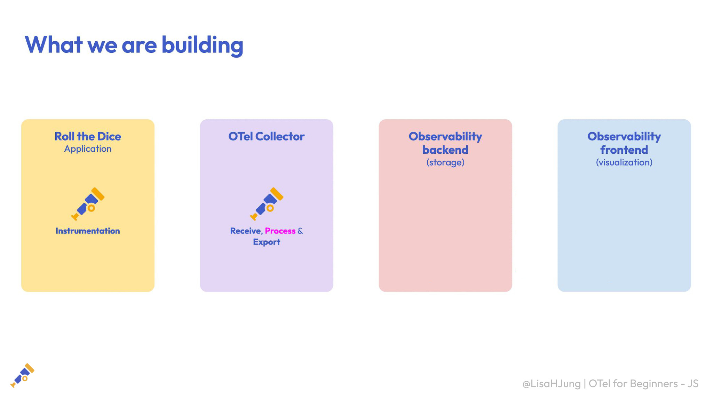

Our setup has four main parts:
- **Roll the Dice**, a simple Node.js app. We'll use OpenTelemetry **instrumentation** to generate traces, metrics, and logs from it.
- The **OpenTelemetry Collector**, which receives, processes, and exports the telemetry from our app.
- An **observability backend**, where our telemetry is stored.
- An **observability frontend**, where we visualize and explore our telemetry.

Together, these four pieces make up a telemetry pipeline. We'll build one for each signal.

**Traces pipeline**

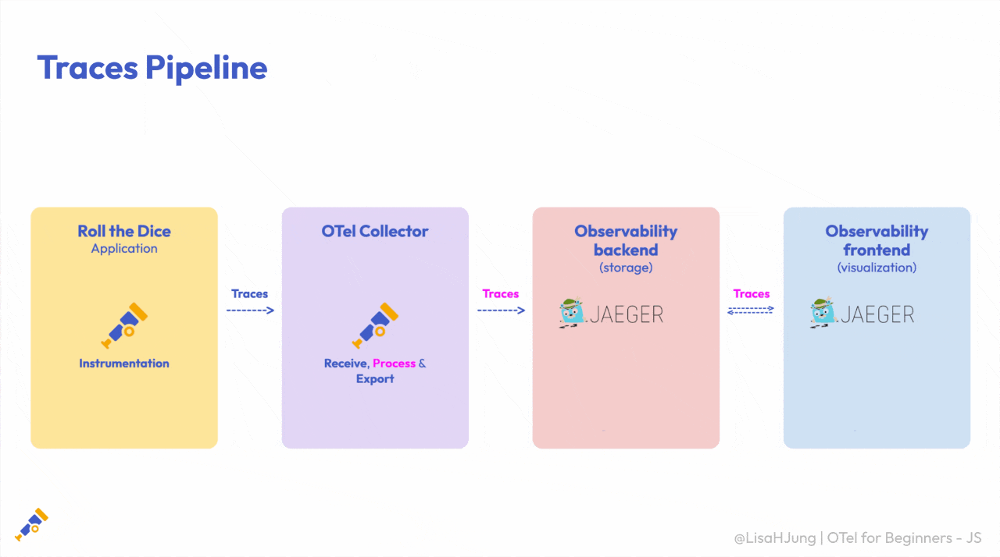

We'll start with traces. We'll use OpenTelemetry's automatic instrumentation to generate traces from our app. Then we'll configure the Collector to receive, process, and export them to **Jaeger**, where we'll store and explore them.

**Metrics pipeline**

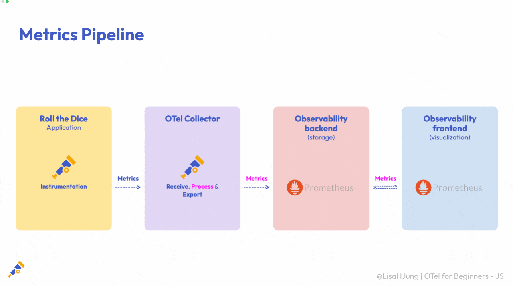

Next, we'll build our metrics pipeline. We'll follow a similar process, but this time we'll use **Prometheus** to store and visualize our metrics.

**Logs pipeline**

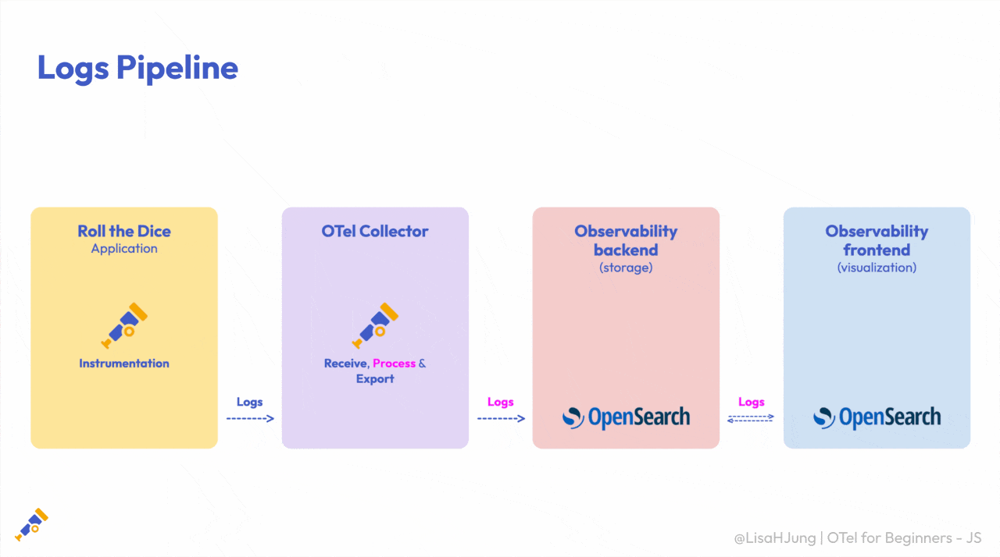

Finally, we'll build our logs pipeline. This time, we'll do something a little different and get our first taste of **manual instrumentation**, adding a few lines of code to our app instead of relying on automatic instrumentation. 

The rest will look familiar. Our logs travel through the Collector to **OpenSearch**, where we'll store and explore them.

And that completes our three pipelines!

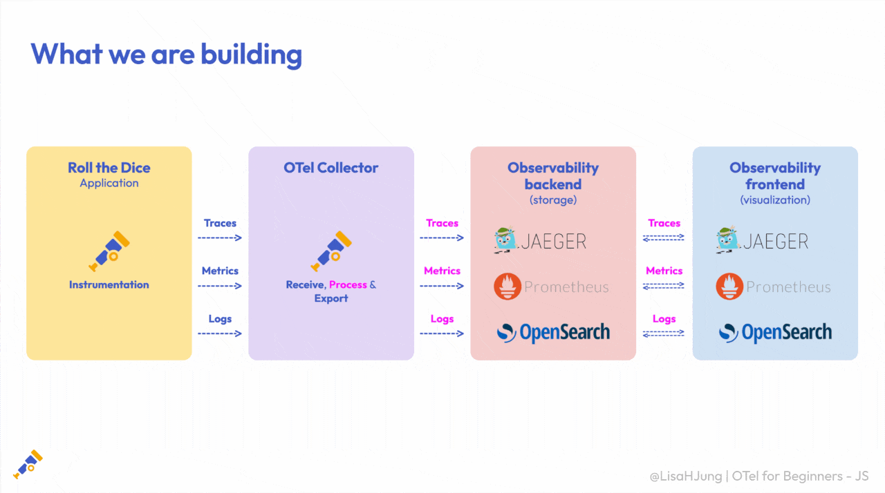

## Our learning environment

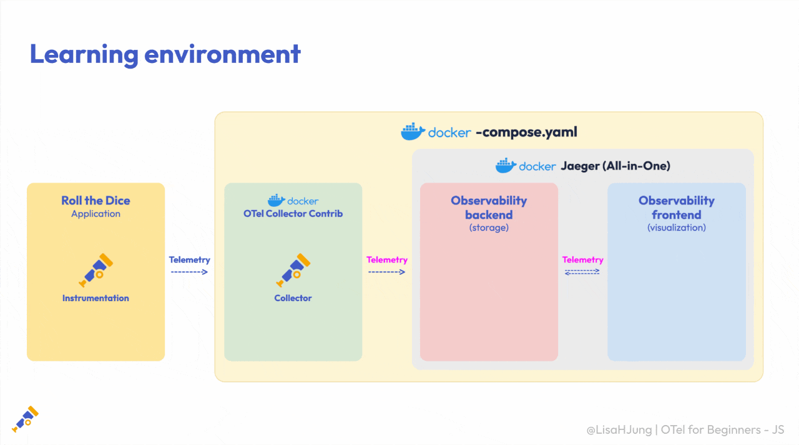

We'll run our Roll the Dice app locally on our computer.

We'll use Docker Compose to run the Collector, along with our observability backends and their visualization tools. This makes it easy to start and manage everything we need for the hands-on exercises.

Here's where you'll find each backend once it's running:

| Signal | Backend | URL |
|---|---|---|
| Traces | Jaeger | http://localhost:16686 |
| Metrics | Prometheus | http://localhost:9090 |
| Logs | OpenSearch Dashboards | http://localhost:5601 |

You won't need all of these right away. Each part of the series only starts the backends it needs, so our environment grows as we add each signal.

## Our two-step approach

For each signal, we'll follow the same two steps. Let's use our traces pipeline as an example.

**Step 1: The bare-bones setup**

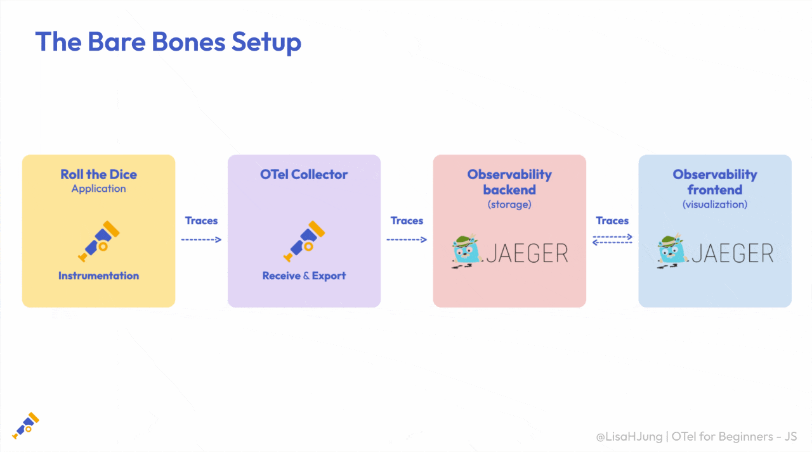

Before we dive into processing, we need to know what our data actually looks like.

So first, we'll build a bare-bones setup with just the essentials to get our telemetry flowing. We'll instrument our app to generate traces, then configure the Collector to receive them and export them to Jaeger. 

From there, we'll explore our traces in Jaeger to see what they look like before any processing.

**Step 2: Enter the processors**

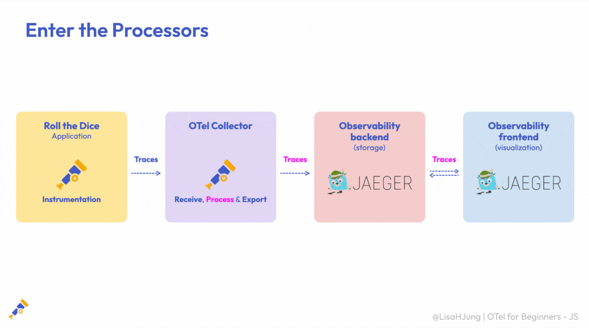

Once we've explored our traces, we'll build on that setup by adding **processors** to the Collector configuration. Processors let us modify, enrich, and filter our telemetry before it's exported.

We'll apply different processors to make the changes we want, then head back to Jaeger to see the results.

We'll follow this same approach for metrics and logs. That's why each signal's folder in the repo has two versions, `bare-bones-setup/` and `add-processors/`.

## The series repo

<!-- TODO screenshot: series repo on GitHub, showing the javascript/traces, metrics, and logs folders -->

Everything we'll use in this series lives in this repo. Each signal has its own folder with a README like this one:

```
javascript/
├── traces/
│   ├── README.md
│   ├── bare-bones-setup/
│   └── add-processors/
├── metrics/
│   ├── README.md
│   ├── bare-bones-setup/
│   └── add-processors/
└── logs/
    ├── README.md
    ├── bare-bones-setup/
    └── add-processors/
```

Once you've installed the [prerequisites](#prerequisites), clone the repo so you're ready to follow along:

```bash
# choose a directory of your choice, then clone the repo
git clone https://github.com/open-telemetry/opentelemetry-for-beginners.git
```

In the next episode, we'll start up our learning environment and build our first pipeline: a bare-bones trace pipeline.

# Episode 3 - Trace Instrumentation & Bare-Bones Collector Configuration

In this episode, we'll build our first pipeline, starting with traces!

## What is a trace?


A **trace** follows a single request as it moves through our app. Each step along the way is recorded as a **span**.

Together, these spans show us how the request moved through our app and how much time it spent at each step.

## The bare-bones setup


As we'll do with each signal, we'll start simple. We'll instrument our app to generate traces, then configure a bare-bones OpenTelemetry Collector, or **the Collector** for short, to receive them and export them to Jaeger.

This lets us explore our traces before we add any processing.

## Run the learning environment

We'll use two terminals: one for the Roll the Dice app and one for Docker.

**Terminal 1: start the app**

From the directory where you cloned the repo, run:

```bash
cd opentelemetry-for-beginners/javascript/traces/bare-bones-setup
npm install
npm start
```


When the app starts, notice our service name, `OTel4Beginners`. We'll see where it comes from [later in this episode](#the-start-script).

**Roll the dice**

In your browser, go to http://localhost:8080/rolldice.

Each time we refresh the page, the app generates a random number between 1 and 6, just like rolling a die. It's intentionally simple, so we can focus on our telemetry instead of how the app works.


**Terminal 2: start the Collector and Jaeger**

Make sure Docker Desktop is running. Then open a second terminal and run these commands from the directory where you cloned the repo:

```bash
cd opentelemetry-for-beginners/javascript/traces/bare-bones-setup
docker compose up
```


**Generate some traces**

Once the Collector and Jaeger are running, head back to the Roll the Dice app and refresh the page a few more times. Each refresh sends a request to our app and generates a trace.


As you refresh, watch the terminal running Docker. You'll see trace data appear as the Collector receives it.


So our app is generating traces, and the Collector is receiving them. But how does our app actually generate these traces?

## Instrumentation: the big picture

The answer is **instrumentation**. Instrumentation enables our app to generate telemetry, like traces, metrics, and logs.

OpenTelemetry gives us different ways to instrument an application. Here are the ones we'll use in this series:

| | Automatic instrumentation | Manual instrumentation |
|---|---|---|
| Also known as | Zero-code solutions | Code-based solutions |
| Code changes | None | Add code |
| Captures | Libraries and runtime | Our app's custom logic |

**Automatic instrumentation**, or auto-instrumentation for short, is ideal when you're getting started or when changing the app isn't an option. It captures telemetry from our app's libraries and runtime environment, giving us useful visibility with very little setup.

**Manual instrumentation** gives us deeper insight. It lets us generate custom telemetry directly from our app logic, alongside the data collected by auto-instrumentation.

For traces, we'll use auto-instrumentation. Let's take a look at the setup that makes it possible.

## The OTel packages

Open the `javascript/traces/bare-bones-setup` folder in your code editor, then open `package.json`.

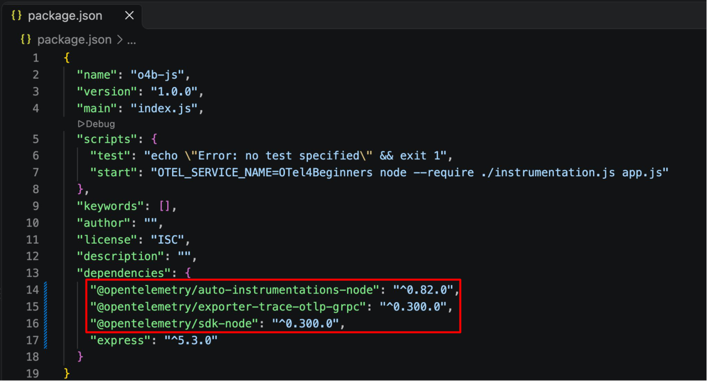

We've installed three OTel packages for this setup:

- **`@opentelemetry/sdk-node`** is the OTel SDK for Node.js. It brings together the components we need to collect and export telemetry.
- **`@opentelemetry/auto-instrumentations-node`** adds instrumentation for popular libraries and frameworks, so we can generate telemetry without changing our app code.
- **`@opentelemetry/exporter-trace-otlp-grpc`** is the OTLP trace exporter. It sends traces over gRPC to the Collector or an OTLP-compatible backend.

Together, these packages let our app generate traces automatically and send them to the Collector.

## instrumentation.js

This file sets up our app to generate traces and send them to the Collector.

```js
const opentelemetry = require('@opentelemetry/sdk-node');

const {
  getNodeAutoInstrumentations,
} = require('@opentelemetry/auto-instrumentations-node');

const {
  OTLPTraceExporter,
} = require('@opentelemetry/exporter-trace-otlp-grpc');

const sdk = new opentelemetry.NodeSDK({
  traceExporter: new OTLPTraceExporter({
     url: 'http://localhost:4317', 
  }),
  instrumentations: [
    getNodeAutoInstrumentations({
      '@opentelemetry/instrumentation-router': { enabled: false },
    }),
  ],
});

sdk.start();
```

It does four main things:

1. **Imports the three OTel packages** we just saw in `package.json`: the OTel SDK, the auto-instrumentation package, and the OTLP trace exporter.
2. **Creates a Node SDK instance** and configures the exporter to send traces to the Collector. We use port `4317`, the default port for OTLP over gRPC.
3. **Enables auto-instrumentation** for common Node.js libraries. We've turned off router instrumentation because Express instrumentation already covers those steps. Keeping both enabled would create duplicate spans.
4. **Starts the SDK** so our app can generate and send traces.

## The start script

Back in `package.json`, we've added a custom `start` script:

```json
"start": "OTEL_SERVICE_NAME=OTel4Beginners node --require ./instrumentation.js app.js"
```


It does two things:

1. **`OTEL_SERVICE_NAME=OTel4Beginners`** gives our service its name (red). 
This tells the backend which service produced the telemetry. We set the name through an environment variable so we can configure it without changing our app code. 

That's the name we saw when we started the app, and we'll use it to find our traces in Jaeger.

2. **`--require ./instrumentation.js`** loads `instrumentation.js` before our app code runs (blue). 

This order matters because the instrumentation needs to be ready when the app starts.

## Collector configuration

Now that our app is set up to generate traces, let's see how the Collector receives and exports them.

**otel/otel-collector-config.yaml**

```yaml
receivers:
  otlp:
    protocols:
      grpc:
        endpoint: 0.0.0.0:4317
      http:
        endpoint: 0.0.0.0:4318

exporters:
  debug:
    verbosity: detailed

  otlp_grpc/jaeger:
    endpoint: jaeger:4317
    tls:
      insecure: true

service:
  pipelines:
    traces:
      receivers: [otlp]
      exporters: [debug, otlp_grpc/jaeger]
```

We're keeping this configuration bare-bones, with three main sections: receivers, exporters, and service pipelines.

### Receivers

```yaml
receivers:
  otlp:
    protocols:
      grpc:
        endpoint: 0.0.0.0:4317
      http:
        endpoint: 0.0.0.0:4318
```

Receivers tell the Collector how to accept incoming telemetry.

- We're using the OTLP receiver with gRPC on port `4317` and HTTP on port `4318`. These are the default ports for OTLP.
- Our app sends traces over gRPC, so it uses port `4317`, matching the exporter setup in `instrumentation.js`.

### Exporters

```yaml
exporters:
  debug:
    verbosity: detailed

  otlp_grpc/jaeger:
    endpoint: jaeger:4317
    tls:
      insecure: true
```

Exporters define where the Collector sends telemetry data. In this setup, we're using two exporters.

- The **`debug`** exporter prints our trace data to the Collector's output.
  - With `verbosity` set to `detailed`, we can inspect individual spans and their details. 
  - That's what we saw in the terminal running Docker when we refreshed the app. 
  - It helps us check what's flowing through the Collector during development and debugging.
- The **`otlp_grpc/jaeger`** exporter sends our traces to Jaeger, where we can store and visualize them.
  - The `otlp_grpc` part identifies the exporter type, an OTLP exporter that sends data over gRPC. The name after the slash helps us tell exporters of the same type apart.
  - The endpoint `jaeger:4317` points to our Jaeger service inside Docker, using the default port for OTLP over gRPC.
  - We've set `insecure` to `true` to turn off TLS for our local demo. In production, we'd use TLS to secure the connection.

### Service

```yaml
service:
  pipelines:
    traces:
      receivers: [otlp]
      exporters: [debug, otlp_grpc/jaeger]
```

Defining receivers and exporters alone doesn't enable them. We need to include them in a pipeline, and that's where the `service` section comes in. It ties everything together by defining how data moves through the Collector.

In our traces pipeline:
- The **`otlp`** receiver accepts traces from our app.
- The **`debug`** exporter prints them to the terminal.
- The **`otlp_grpc/jaeger`** exporter sends them to Jaeger.

**Putting it all together**

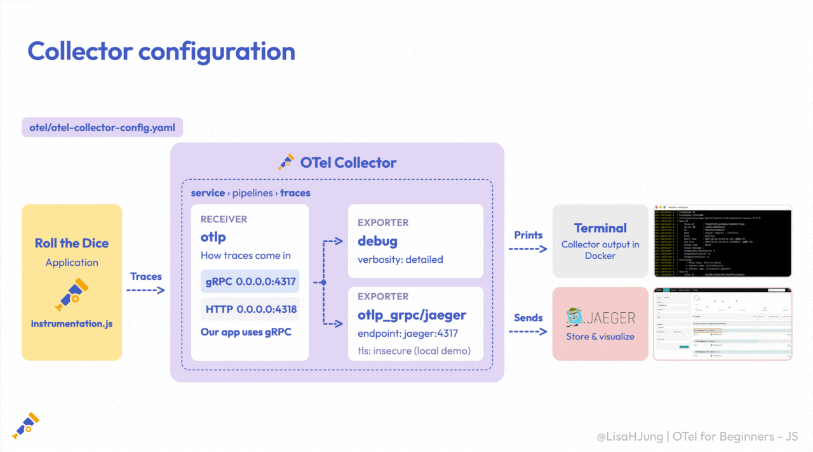

Our app sends traces over gRPC to the Collector's OTLP receiver. Inside our traces pipeline, the receiver passes them to both exporters. The `debug` exporter prints them to the terminal, while `otlp_grpc/jaeger` sends them to Jaeger, where we can store and visualize them.

## Explore our traces in Jaeger

Now let's check that our traces are reaching Jaeger.

**1. Find our traces**

Go to http://localhost:16686 to access the Jaeger UI. In the **Service** dropdown (orange box), select `OTel4Beginners`, the service name we set in our start script. Then click **Find Traces** (blue arrow).

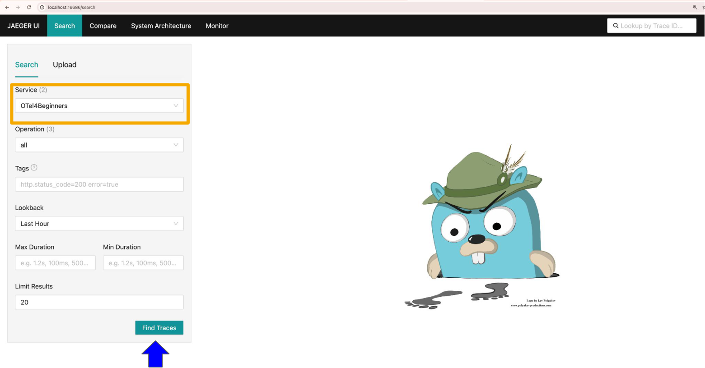

> **Don't see `OTel4Beginners`?** Refresh the Roll the Dice app a few more times. Check that trace data appears in the terminal running Docker, then refresh Jaeger and try again.

**2. Look at the results**

Now we can see the traces generated by our app, flowing through the Collector and into Jaeger.


- The chart at the top shows our traces as dots, plotted by when each request happened and how long it took.
- Each result in the list is a trace, representing one request to our app.
- Each trace is made up of spans, the steps that make up that request.

Click on one of the traces (orange box) to take a closer look.

**3. Read the trace timeline**


This is the trace timeline. It brings the [trace diagram](#what-is-a-trace) to life with real trace data.

- At the top is our **root span**, `GET /rolldice` (yellow box), which covers the whole request.
- Below it is a **child span** (blue box) showing the work done by our request handler.
- Each bar shows how long that span took.

Our diagram also showed a middleware step, but our app is simple, so there's only one step here. In a real app, you'd see many more spans, like database calls or requests to other services.

**4. Open the root span**

Click on the root span, `GET /rolldice`. The span opens up to show its details, in two sections: **Tags** and **Process** (orange box). Expand both to take a closer look.


### Tags: span attributes

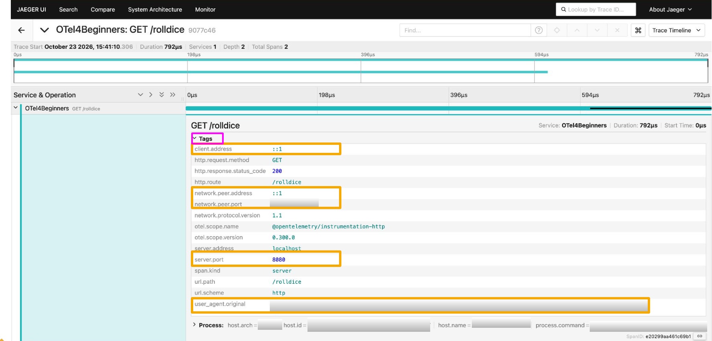

The **Tags** section gives us details about the request. These are **span attributes**, like the route, method, and status code. They help us understand how our app handled the request.

We can also see details like the user agent, IP addresses, and ports that we may not need. Some could reveal information about users or their devices in production. We're running locally, but some values have been blurred in the screenshots to show what we'd want to handle carefully.

In the next episode, we'll use processors to remove these attributes (orange boxes):
- `client.address`
- `network.peer.address`
- `network.peer.port`
- `server.port`
- `user_agent.original`

### Process: resource attributes


The **Process** section shows details about the service that created this telemetry, like the host and the running process. These are called **resource attributes**. Instead of describing the request, they describe the source of our telemetry.

Like the Tags section, this includes details we may not need, such as host identifiers and process details. Some could reveal information about our machines in production, so their values have been blurred in the screenshots.

In the next episode, we'll use processors to remove these too (orange boxes):
- `host.arch`
- `host.id`
- `host.name`
- `process.command`
- `process.command_args`
- `process.executable.path`
- `process.owner`
- `process.pid`

And that's our first pipeline up and running! In the next episode, we'll add processors to modify, enrich, and clean up our traces before they reach Jaeger.

# Episode 5 - Processing Traces: OpenTelemetry Collector in Action

Objectives:
- Add resource context (deployment.environment.name)
- Remove noisy/sensitive resource + span attributes
- Batch spans for efficient export

## Project folders 


1. `bare-bones-setup/` (**Episode 4**)
- Instruments the Roll the Dice app and sends traces to the OpenTelemetry Collector.
- The Collector forwards traces to Jaeger for storage and visualization with no additional processing.


2. `add-processors/` (**Current episode**)
- Uses the same setup as `bare-bones-setup`, but applies processors to incoming traces.
- These processors enrich resource metadata, remove low-value or sensitive attributes, and batch traces for more efficient exporting.

*At this point, you should still have two terminals open: one for the Roll the Dice app, and one for Docker.*

### Step 1: Switch folders + restart app (Terminal 1)
In the terminal running the Roll the Dice app, stop the app, navigate to the `add-processors` folder, and restart the app.

```
# stop the app
CTRL + C

# navigate to the add-processors folder
cd ../add-processors

# install dependencies and start the app
npm install
npm start
``` 
### Step 2: Restart Collector + Jaeger (Terminal 2)
In the terminal running Docker, stop the OpenTelemetry Collector and Jaeger, navigate to the `add-processors` folder, and restart them.
```
# stop the running containers
CTRL + C

# navigate to the add-processors folder
cd ../add-processors

# restart with the updated configuration
docker compose up --build 
```
This reloads the Collector with the updated processor configuration. 

### Step 3: Generate traces
Refresh the Roll the Dice app page multiple times at `http://localhost:8080/rolldice` to send traces to the newly configured OpenTelemetry Collector.


### Step 4: Verify traces (Collector logs and Jaeger UI) 

Check the Collector logs to verify that traces are flowing through the Collector.


Open the Jaeger UI at `http://localhost:16686` and take a look at the new traces coming in.


Now that we’ve confirmed the newly transformed traces are flowing through the Collector, let’s examine the updated configuration to understand how trace data is processed before export.

After that, we’ll look at the new traces in more detail to see how the processors have transformed them.

## New OpenTelemetry Collector Configuration

### Processors modify, filter, or enrich telemetry data within the Collector before it is exported.

Three processors have been added to the Collector configuration to modify trace data before export:
1. `resource` 
2. `attributes` 
3. `batch` 

**otel/otel-collector-config.yaml**
```
receivers:
  otlp:
    protocols:
      grpc:
        endpoint: 0.0.0.0:4317
      http:
        endpoint: 0.0.0.0:4318

processors:
  resource:
    attributes:
      - key: deployment.environment.name
        value: local
        action: insert
      - key: host.arch
        action: delete
      - key: host.id
        action: delete
      - key: host.name
        action: delete  
      - key: process.command
        action: delete
      - key: process.command_args
        action: delete
      - key: process.executable.path
        action: delete
      - key: process.owner
        action: delete
      - key: process.pid
        action: delete

  attributes:
    actions:
      - key: http.user_agent
        action: delete
      - key: net.host.ip
        action: delete
      - key: net.peer.ip
        action: delete
      - key: net.host.port
        action: delete
      - key: net.peer.port
        action: delete

  batch:
    timeout: 5s
    send_batch_size: 512

exporters:
  debug:
    verbosity: detailed

  otlp_grpc/jaeger:
    endpoint: jaeger:4317
    tls:
      insecure: true

service:
  pipelines:
    traces:
      receivers: [otlp]
      processors: [resource, attributes, batch]
      exporters: [debug, otlp_grpc/jaeger]
```
**1. The `resource` processor modifies metadata about the service or host.**

In this configuration, the resource processor inserts a new resource attribute called `deployment.environment.name` and sets its value to `local`.

This makes it easier to identify where traces are coming from when working across multiple environments.

```
processors:
  resource:
    attributes:
      - key: deployment.environment.name
        value: local
        action: insert
```

**After (processed telemetry)**


In addition, the following resource attributes were deleted to remove low-value or sensitive host and process metadata.

```
processors:
  resource:
    attributes:
      - key: host.arch
        action: delete
      - key: host.id
        action: delete
      - key: host.name
        action: delete  
      - key: process.command
        action: delete
      - key: process.command_args
        action: delete
      - key: process.executable.path
        action: delete
      - key: process.owner
        action: delete
      - key: process.pid
        action: delete
```

This helps reduce noise, improve privacy, and keep trace data focused.

**Before (raw telemetry)**


**After (processed telemetry)**


**2. The `attributes` processor modifies, adds, or removes span attributes.**

The following span attributes were deleted to keep span data focused on application behavior rather than client or network details.

```
processors:
  attributes:
    actions:
      - key: http.user_agent
        action: delete
      - key: net.host.ip
        action: delete
      - key: net.peer.ip
        action: delete
      - key: net.host.port
        action: delete
      - key: net.peer.port
        action: delete
```

**Before (raw telemetry)**


**After (processed telemetry)**


**3. The `batch` processor groups telemetry data into batches before exporting.**
```
batch:
    timeout: 5s
    send_batch_size: 512

```
As a best practice, the `batch` processor should almost always be included in production-ready Collector configurations.

Adjust these parameters to fit your specific use case.

**The service component was updated to tie the receivers, processors, and exporters together into a traces pipeline.**

```
service:
  pipelines:
    traces:
      receivers: [otlp]
      processors: [resource, attributes, batch]
      exporters: [debug, otlp_grpc/jaeger]
```

**IMPORTANT**

In the `service` component, processors are applied in the order they are listed in the pipeline.

The `batch` processor should be listed **last** so it can batch the final version of the data before exporting.

In the next episode, we’ll shift focus from traces to metrics and walk through how to collect, process, and export application metrics using the OpenTelemetry Collector.
