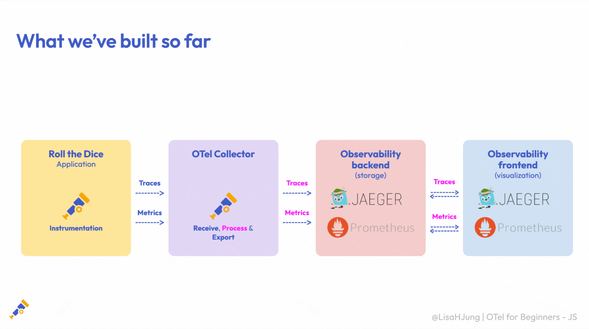
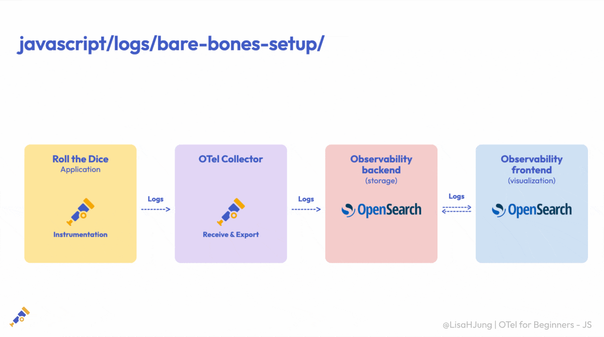
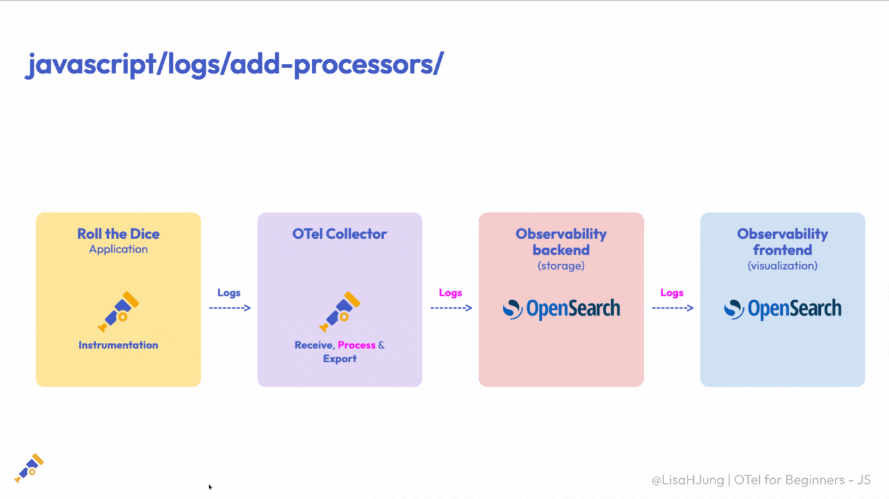
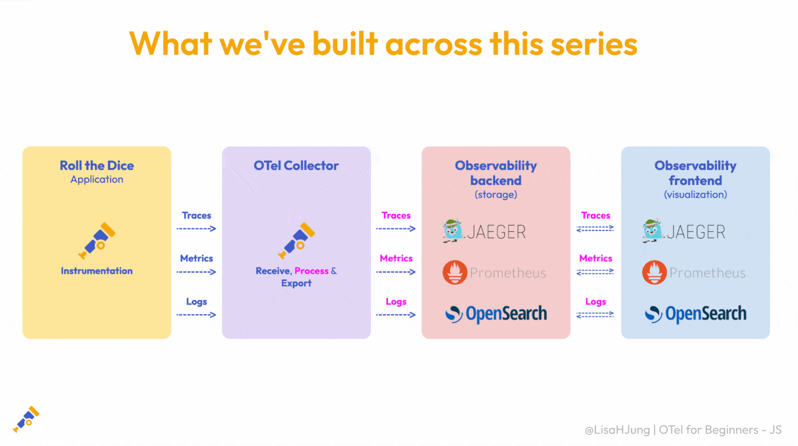

# OpenTelemetry for Beginners - The JavaScript Journey (Logs)

Getting started with OpenTelemetry can feel overwhelming, but this beginner series for JavaScript developers will guide you step by step. This guide covers the **logs** signal and builds directly on the traces and metrics guides.

> **New to the series?** Start with the [Traces walkthrough](../traces/README.md), which covers Episode 1 (_What is OpenTelemetry?_), the pipeline overview, and setting up your learning environment, then the [Metrics walkthrough](../metrics/README.md). This logs guide picks up from there and assumes you've met the same prerequisites and are comfortable running the Roll the Dice app.

## Prerequisites

Same as the earlier guides. Before getting started, make sure you have installed:
- [Node.js](https://nodejs.org/en/download/)
- [Docker Desktop](https://www.docker.com/products/docker-desktop/)
- [Docker Compose](https://docs.docker.com/compose/install/)

## Resources
- [OpenTelemetry documentation](https://opentelemetry.io/docs/)
  - Ask AI (⌘+K shortcut)
  - [Language APIs and SDKs](https://opentelemetry.io/docs/languages/)
  - [Logs](https://opentelemetry.io/docs/concepts/signals/logs/)
  - [OpenTelemetry Collector](https://opentelemetry.io/docs/collector/)
    - [List of OpenTelemetry Collector processors](https://github.com/open-telemetry/opentelemetry-collector-contrib/tree/main/processor)
  - [Transform processor (OTTL)](https://github.com/open-telemetry/opentelemetry-collector-contrib/tree/main/processor/transformprocessor)
- [OpenSearch documentation](https://docs.opensearch.org/)
- [OpenTelemetry YouTube channel](https://www.youtube.com/@otel-official)
  - [OpenTelemetry for Beginners series - The JavaScript Journey](https://youtu.be/iEEIabOha8U?feature=shared)
- [OpenTelemetry Slack channel](https://opentelemetry.io/community/end-user/slack-channel/)

# Episode 8 - Logs Instrumentation and Bare-Bones OTel Collector Configuration

In the trace and metric episodes, we instrumented our app, sent telemetry through the OpenTelemetry Collector, and visualized it in a backend.



Those two signals, traces and metrics, are only part of the picture. The third is **logs**.

If you've ever debugged an app by reading through its output, you've already worked with logs. 

They give us a record of individual events, helping us understand what happened and when. That focus on individual events is what sets logs apart from the other signals. 

A metric tells us _how many_ requests came in or _how long_ they took, and a trace tells us the path of a single request, but a log captures _what happened_ at a specific moment.

Just like we did with traces and metrics, we're going to start simple. 

We'll configure a bare-bones OTel Collector to receive logs and export them to OpenSearch. We'll use this setup to explore our logs as they are, before we start processing them. 



Then, in the next episode, we'll add processors and see how we can transform our logs before they're exported. Let's get everything set up.

## Run the learning environment locally

If you've been following along from the metrics episode, you should already have two terminals open. 

One running the Roll the Dice app and another running Docker. We'll reuse both. 

In each terminal, stop what's running, move into the `logs/bare-bones-setup` folder, and start it back up. Make sure Docker Desktop is open and running before you bring the stack up.

**Terminal 1 - Roll the Dice app**
```bash
# stop the running app
Ctrl + C
# move to the logs bare-bones folder
cd ../../logs/bare-bones-setup
# install this folder's dependencies, then start the app
npm install
npm start
```

**Terminal 2 - Docker (Collector + Jaeger + Prometheus + OpenSearch)**
```bash
# stop and remove the metrics stack
docker compose down
# move to the logs bare-bones folder
cd ../../logs/bare-bones-setup
# bring the stack up (bare-bones logs setup, adds OpenSearch)
docker compose up
```

This bare-bones setup runs the Collector, Jaeger, Prometheus, OpenSearch, and OpenSearch Dashboards side by side with our app. For logs, OpenSearch is our backend for storing and searching, and OpenSearch Dashboards is where we'll explore them.

Once everything is running, we're ready to generate some logs.

**Verify the app is running**

In your browser, go to the following URL: http://localhost:8080/rolldice

Refresh the page multiple times. This app will generate a random number from 1–6, just as if you were rolling a die. Every roll also emits a log record.


**See the logs flow through the Collector**

Take a look at the terminal that is running Docker. You'll see logs flowing through the Collector.


One thing to keep in mind. Unlike traces, our logs are **batched** before they're sent, so they won't appear the instant you roll. Give it a few seconds, then look for them.

Because each log is small compared to the metrics output, it's easy to scroll past. To make them easy to spot, you can run this command to filter the Collector's output down to just the log records.

Our other two terminals are busy running the app and Docker, so open a third terminal and run the following command.

**Terminal 3 - Filtered Collector output**
```
# in a new terminal, within the logs/bare-bones-setup folder
docker compose logs otel-collector -f | grep --line-buffered -A8 "LogRecord #"
```


Since we know our app is generating logs and the Collector is receiving them, let's head into the code and see how those logs are being generated.

> **Quick heads-up.** To keep things easy to follow, the code snippets below only show the logs-related bits. Your actual files have more going on, the traces and metrics setup from the earlier episodes (in `instrumentation.js` and the Collector config) and the rest of the app's own code (in `app.js`), we've just trimmed it out here so it's easier to focus on logs.

## The packages (package.json)

For our logs example, we've added three OpenTelemetry packages on top of what the earlier episodes used:


- `@opentelemetry/api-logs` is the **Logs API**. It lets our app create log records in our code.
- `@opentelemetry/sdk-logs` is the **Logs SDK**. It collects those records and prepares them for export.
- `@opentelemetry/exporter-logs-otlp-grpc` is the **OTLP log exporter**, which sends our log records to the Collector over gRPC.

Together, these let our app create logs and send them to the Collector.

Now that we’ve covered the packages, let’s see how we use them in our app. 

## instrumentation.js

This file prepares our app to generate logs and send them to the local Collector. It should look familiar from the traces and metrics setup, with the logs pieces added:

```
const opentelemetry = require('@opentelemetry/sdk-node');

const {
  getNodeAutoInstrumentations,
} = require('@opentelemetry/auto-instrumentations-node');

const {
  OTLPLogExporter,
} = require('@opentelemetry/exporter-logs-otlp-grpc');

const {
  BatchLogRecordProcessor,
} = require('@opentelemetry/sdk-logs');

const sdk = new opentelemetry.NodeSDK({
  // ...trace and metric configuration from the earlier episodes...
  logRecordProcessors: [
    new BatchLogRecordProcessor(
      new OTLPLogExporter({
        url: 'http://localhost:4317',
      }),
    ),
  ],
  instrumentations: [getNodeAutoInstrumentations()],
});

sdk.start();
```

At a high level, `instrumentation.js` does the same four things it did for metrics, with one addition for logs:

1. Import the OpenTelemetry SDK and the auto-instrumentation module, along with the OTLP log exporter and the batch log record processor.
2. Create a new `NodeSDK` instance.
3. For logs, add that **batch log record processor**, wrapping the OTLP log exporter. It groups our log records together before sending them to the Collector listening on port `4317`, the standard OTLP endpoint. That's why our logs show up in the debug output in small batches, a few seconds after we roll.
4. Start the SDK.

## app.js

Up to now, OpenTelemetry has auto-generated traces and metrics, without us changing a line of application code. That's **automatic instrumentation**. 

Logs are the exception. Because our app has no logging library for OpenTelemetry to hook into automatically, we create the log record ourselves with the Logs API. 

This is **manual instrumentation**:

```
const { logs, SeverityNumber } = require('@opentelemetry/api-logs');

const logger = logs.getLogger('rolldice-app');

app.get('/rolldice', (req, res) => {
  const roll = getRandomNumber(1, 6);

  logger.emit({
    severityNumber: SeverityNumber.INFO,
    severityText: 'INFO',
    body: `Rolled a dice and got ${roll}`,
    attributes: { 'dice.value': roll },
  });

  res.send(roll.toString());
});
```

Every time we roll the dice, we call the logger and create a log record. That record carries:
- a **severity** of `INFO`, which marks this as a routine event,
- a **body**, the message `Rolled a dice and got <value>`, and
- a `dice.value` **attribute**, which pulls out the specific number we rolled.

Notice that every roll is emitted at that same `INFO` severity, whether we roll a one or a six. We'll put that severity to work in the next episode.

This is our first taste of **manual instrumentation**. We write the code ourselves to record an event that matters to us, one auto-instrumentation couldn't capture on its own. 

Now that we've seen how our app generates logs, let's look at how the Collector receives and exports them.

## OpenTelemetry Collector Configuration

**otel/otel-collector-config.yaml**
```
receivers:
  otlp:
    protocols:
      grpc:
        endpoint: 0.0.0.0:4317
      http:
        endpoint: 0.0.0.0:4318

exporters:
  debug:
    verbosity: detailed

  otlp/jaeger:
    endpoint: jaeger:4317
    tls:
      insecure: true

  prometheus:
    endpoint: 0.0.0.0:8889

  opensearch:
    http:
      endpoint: http://opensearch:9200
    logs_index: otel-logs

service:
  pipelines:
    traces:
      receivers: [otlp]
      exporters: [debug, otlp/jaeger]
    metrics:
      receivers: [otlp]
      exporters: [debug, prometheus]
    logs:
      receivers: [otlp]
      exporters: [debug, opensearch]
```

Just like before, our configuration has three main parts. Receivers, exporters, and service pipelines. 

Our receiver hasn't changed, so let's start with the exporter, then we'll take a look at the logs pipeline.

**Exporters define where the Collector sends telemetry.** 

For logs, we use two:
```
exporters:
  debug:
    verbosity: detailed

  opensearch:
    http:
      endpoint: http://opensearch:9200
    logs_index: otel-logs
```
- The **`debug` exporter** prints our logs to the Collector's logs so we can verify they're flowing through. 
- The **`opensearch` exporter** is where things change. 

For traces we exported to Jaeger, and for metrics to Prometheus. 

This time we send our logs to **OpenSearch**, our backend for storing and searching logs. It writes them to an index called `otel-logs`. We'll explain what an index is shortly.

**The `service` component defines how data moves through the Collector.**
```
service:
  pipelines:
    logs:
      receivers: [otlp]
      exporters: [debug, opensearch]
```
- The **`otlp` receiver** accepts logs from our app.
- The **`debug` exporter** prints them to the terminal.
- The **`opensearch` exporter** sends them to OpenSearch for storage.

Together, these components define the path our logs take through the Collector.

Now that everything is configured, let’s see it in action.

## Exploring logs in OpenSearch Dashboards

Open your browser and go to `http://localhost:5601` to reach OpenSearch Dashboards, where we'll explore our logs. 


Before we can see them, there’s one thing we need to set up.

**What's an index?**

Back in the Collector config, the `opensearch` exporter sets `logs_index` to `otel-logs`.

```yaml
exporters:
  opensearch:
    http:
      endpoint: http://opensearch:9200
    logs_index: otel-logs
```

That tells OpenSearch to group our records together under that name, and that grouping is what OpenSearch calls an **index**. 

Think of it like a folder for related data that keeps everything organized and easy to find.

**What's an index pattern?**

Our data is already in OpenSearch, but Dashboards still needs to know which index we want to explore. That's what an **index pattern** is for, a saved pointer that tells Dashboards where to look. We'll create one that points to `otel-logs`.

**Create the index pattern**
1. From the OpenSearch Dashboards home page, click **Manage** in the top-right corner.
   

2. In the menu on the left, select **Index patterns**, then click **Create index pattern**.
   
   

3. For the index pattern name, enter `otel-logs`. You'll see it match the `otel-logs` index below. Click **Next step**.
   

4. Open the time field dropdown and select `@timestamp`, then click **Create index pattern**.
   
> **A note on timestamps.** 

Each log carries two. `@timestamp` is when the event happened in our app, and `observedTimestamp` is when the SDK collected it (a few seconds later, because of batching). 

We use `@timestamp` so our logs line up on the timeline by when we actually rolled the dice.

**View your logs**
1. Open the menu in the top-left corner and select **Discover**.
   

2. Make sure `otel-logs` is selected in the dropdown near the top-left.
   

3. Remember, our app only creates logs when we roll, so head back to the Roll the Dice app and roll a few times.
   
4. Then return to **Discover**, set the time range (top-right) to **Last 15 minutes**, and click **Refresh**.
   

If you see "No results," give the batch a few seconds and check that your time range covers the last few minutes.

Once your records appear, **expand one** by clicking the arrow at the start of its row and read through it top to bottom. 


This is where the body and `dice.value` attribute we added back in `app.js` finally show up, now that the log has made its way through the Collector and into OpenSearch.


- **`body`** holds the message we wrote in our code (app.js), `Rolled a dice and got <value>`. It tells us what happened.
- **`attributes.dice.value`** (just above the body) pulls out a specific detail, the number we rolled.


The **`resource`** fields are **resource attributes**.


Instead of describing the event, they tell us where the telemetry came from, our application, process, and host. Because they describe the source and not the event, they stay the same on every log, unlike `dice.value`, which changes with each roll. 

Just like we saw with traces and metrics, many were added automatically, and some are more than we need, like host identifiers, the process owner, and the command used to start our app. We'll clean these up in the next episode.


The **severity** fields tell us how important an event is. 

We set every roll to `INFO` because they're routine, so here we see a `severity.text` of `INFO` and a `severity.number` of `9`.

That `9` has nothing to do with the number we rolled, in OpenTelemetry, `9` is the `INFO` level. In the next episode we'll give our rolls different severity levels and use them to filter our logs.


At the bottom is the **trace context**, a `traceId` and `spanId` we never added ourselves. 

OpenTelemetry attached them automatically because this log was created while a traced request was running. The `traceId` links this log to that request's trace, so we can jump straight from a log to the full request it belongs to.

**Scan many logs at once.** 

Expanding one record is great for a single event, but to compare several at a glance we can turn fields into columns. 

Under **Available fields** on the left, find `attributes.dice.value` and `severity.text` and click **Add** for each. 

Now every row shows the roll next to its severity. Keep this view in mind, it's exactly how we'll compare our logs before and after processing in the next episode.


Now that logs are being generated and exported through the Collector, we can start processing them before they're stored.

# Episode 9 - Processing Logs: OpenTelemetry Collector in Action

In the last episode, we got our bare-bones logs pipeline up and running. Our app generated logs, the Collector exported them to OpenSearch, and we explored them in OpenSearch Dashboards.


As we looked through those logs, a few things stood out that we could improve.

Our logs carried host and process details we don't really need. Every roll also came through with the same `INFO` severity, whether we rolled a one or a six.

And we were storing every single roll, even though we might not need all of them.

That's where **processors** come in.

If you followed along with the traces and metrics episodes, processors should look familiar. They run inside the OTel Collector and let us modify, enrich, and filter our telemetry before it's exported. This time, we'll put them to work on our logs.



In this episode, we'll:
1. **Clean up** the resource attributes we don't need.
2. **Enrich** our logs by giving some of our dice rolls a different severity.
3. **Filter** our logs, using those severity levels to decide which ones to keep.

Let's get everything ready.

## Run the learning environment locally

If you've been following along from the last episode, you should already have two terminals open.

One is running the Roll the Dice app and the other is running Docker. We'll reuse both.

If you still have the third terminal open with the filtered Collector output, go ahead and stop it with `Ctrl + C`.

In the first two terminals, stop what's running, move into the `logs/add-processors` folder, and start everything back up.

**Terminal 1 - Roll the Dice app**
```bash
# stop the running app
Ctrl + C
# move to the logs add-processors folder
cd ../add-processors
# install this folder's dependencies, then start the app
npm install
npm start
```

**Terminal 2 - Docker (Collector + Jaeger + Prometheus + OpenSearch)**
```bash
# stop and remove the bare-bones stack
docker compose down
# move to the logs add-processors folder
cd ../add-processors
# bring the stack up with the new processors config
docker compose up
```

Once everything is running, we're ready to generate some logs.

In your browser, go to http://localhost:8080/rolldice and refresh the page a few times to roll the dice.


Now that our logs are flowing, let's take a look at the configuration that's processing them.

## New OpenTelemetry Collector Configuration

In your code editor, make sure the `logs/add-processors` folder is open. Then head into the `otel` directory and open `otel-collector-config.yaml`.

In our bare-bones setup, our configuration had three main parts: receivers, exporters, and service pipelines. This time, there's a fourth, **processors**.

You'll notice this config has pipelines for traces, metrics, and logs, and some of the processors are shared across them. For this episode, we'll focus on the logs pipeline.

> **Quick heads-up.** Just like in the last episode, the snippet below only shows the logs-related bits. Your actual file also includes the traces and metrics processors and exporters from the earlier episodes, we've just trimmed them out here so it's easier to focus on logs.

**otel/otel-collector-config.yaml**
```yaml
receivers:
  otlp:
    protocols:
      grpc:
        endpoint: 0.0.0.0:4317
      http:
        endpoint: 0.0.0.0:4318

processors:
  resource:
    attributes:
      - key: deployment.environment.name
        value: local
        action: insert
      - key: host.arch
        action: delete
      - key: host.id
        action: delete
      - key: host.name
        action: delete
      - key: process.command
        action: delete
      - key: process.command_args
        action: delete
      - key: process.executable.path
        action: delete
      - key: process.owner
        action: delete
      - key: process.pid
        action: delete

  transform/logs:
    log_statements:
      - set(log.severity_number, SEVERITY_NUMBER_WARN) where log.attributes["dice.value"] == 1
      - set(log.severity_text, "WARN") where log.attributes["dice.value"] == 1

  filter/logs:
    log_conditions:
      - 'log.severity_number < SEVERITY_NUMBER_WARN'

exporters:
  debug:
    verbosity: detailed

  opensearch:
    http:
      endpoint: http://opensearch:9200
    logs_index: otel-logs
    sending_queue:
      sizer: items
      batch:
        flush_timeout: 5s
        min_size: 512

service:
  pipelines:
    logs:
      receivers: [otlp]
      processors: [resource, transform/logs, filter/logs]
      exporters: [debug, opensearch]
```

Our logs pipeline uses three processors: `resource`, `transform`, and `filter`. Let's walk through them one at a time.

## 1. The `resource` processor

**The `resource` processor modifies the resource attributes that describe where our telemetry came from.**

We've already used this one in our traces and metrics episodes.

```yaml
processors:
  resource:
    attributes:
      - key: deployment.environment.name
        value: local
        action: insert
      - key: host.arch
        action: delete
      - key: host.id
        action: delete
      - key: host.name
        action: delete
      - key: process.command
        action: delete
      - key: process.command_args
        action: delete
      - key: process.executable.path
        action: delete
      - key: process.owner
        action: delete
      - key: process.pid
        action: delete
```

In our config, it does two things:
- It **inserts** `deployment.environment.name` and sets it to `local`, so we can tell at a glance which environment our telemetry came from.
- It **deletes** the host and process details we spotted in the last episode, like `host.id`, `process.owner`, and the command used to start our app.

The same `resource` processor is shared across our traces, metrics, and logs pipelines.

**Follow along in OpenSearch Dashboards**

Want to see these changes on your own setup? Open OpenSearch Dashboards at http://localhost:5601 and head to **Discover**.

If you need to recreate the `otel-logs` index pattern, follow the same steps from the last episode, using `otel-logs` for the name and `@timestamp` for the time field.

Then expand a log record, and you'll be able to spot the changes for yourself.

For each processor, we'll compare our logs from the bare-bones setup (**before**) with our processed logs (**after**).

**Before: logs from the bare-bones setup**

Remember all those `resource.host` and `resource.process` attributes we saw when we expanded a log in the last episode?

<!-- TODO screenshot of an expanded bare-bones log record highlighting the resource.host and resource.process attributes -->

**After: logs from the new Collector configuration**

Now let's compare that with our processed logs. Here, the before and after views are side by side so it's easy to see what changed.

<!-- TODO side-by-side screenshot: bare-bones log record (left) and processed log record with deployment.environment.name = local (right) -->

On the left are our original logs, with all those host and process details.

On the right, after applying the `resource` processor, those details are gone. In their place, we have a new resource attribute, `deployment.environment.name`, set to `local`.

With just one processor, we've removed the details we don't need and added the context we do.

## 2. The `transform` processor

**The `transform` processor modifies the log records themselves.**

While the `resource` processor works on where our telemetry came from, the `transform` processor lets us change different parts of each log record.

It uses the **OpenTelemetry Transformation Language**, or **OTTL**, to describe the changes we want to make.

We won't dive into OTTL itself in this series, but we'll see an example of what it can do. If you'd like to learn more, check out the [Transform processor (OTTL)](https://github.com/open-telemetry/opentelemetry-collector-contrib/tree/main/processor/transformprocessor) link in the [Resources](#resources) section.

```yaml
processors:
  transform/logs:
    log_statements:
      - set(log.severity_number, SEVERITY_NUMBER_WARN) where log.attributes["dice.value"] == 1
      - set(log.severity_text, "WARN") where log.attributes["dice.value"] == 1
```

In our example, we're going to change the **severity** of some of our logs.

Let's pretend that rolling a one is something we want to flag. Whenever `dice.value` is `1`, these two statements raise the severity from `INFO` to `WARN`:
- `severity_number` becomes `SEVERITY_NUMBER_WARN`, which is `13` in OpenTelemetry.
- `severity_text` becomes `WARN`.

Flagging those rolls helps them stand out from the rest, and it sets us up to decide which logs to keep in the next step.

Of course, in a real application, what we flag depends on what matters for our use case.

Now let's see what this looks like in Discover.

**Before: logs from the bare-bones setup**

Here, the dice value and severity are shown side by side. Notice that every roll, from one through six, came through with the same `INFO` severity.

<!-- TODO screenshot of bare-bones Discover with attributes.dice.value and severity.text columns, all INFO -->

**After: logs from the new Collector configuration**

To compare, let's set up the same view on our live dashboard that we used in the last episode.

Under **Available fields** on the left, find `attributes.dice.value` and `severity.text` and click **Add** for each. Now every row shows the roll next to its severity.

<!-- TODO screenshot of processed Discover with attributes.dice.value and severity.text columns -->

Let's expand one of the records and scroll down to `attributes.dice.value`.

<!-- TODO screenshot of an expanded processed log record with dice.value = 1 and severity.text = WARN -->

Remember, in our bare-bones setup, every roll came through as `INFO`, including the ones.

Now, the dice value is `1` and the severity is `WARN`. That's our `transform` processor at work, changing the severity exactly as we configured it.

Now let's close this record and take a look at the rest of our logs.

Here's where things get interesting. Every log record we're seeing has a dice value of one.

It's pretty unlikely that we rolled a one every single time. So what happened to all the other rolls? That's where our next processor comes in.

## 3. The `filter` processor

**The `filter` processor drops the telemetry we don't need before it's exported.**

Not every log needs to be stored. As the amount of log data grows, keeping only what we need can save storage and make our logging setup more cost-efficient.

```yaml
processors:
  filter/logs:
    log_conditions:
      - 'log.severity_number < SEVERITY_NUMBER_WARN'
```

The `filter` processor drops any log record that matches its condition. In our example, that's anything with a severity below `WARN`.

Since our rolls of one are now `WARN` and the rest are still `INFO`, only the ones make it through.

Let's see the difference in OpenSearch.

**Before: logs from the bare-bones setup**

Every roll made it to OpenSearch, from one through six. At the top, we can also see the total number of log records.

<!-- TODO screenshot of bare-bones Discover showing dice values 1-6 and the total hit count -->

**After: logs from the new Collector configuration**

Take a look at the results count. We have far fewer records than before.

And notice what's left. Every dice value is `1`, and every severity is `WARN`.

<!-- TODO screenshot of processed Discover showing only dice.value = 1 / WARN and the lower hit count -->

By combining the `transform` and `filter` processors, we can flag the events we care about and filter out the rest before they're stored.

## Batching at the exporter

Now that we've covered our processors, let's scroll down to the exporters.

**Exporters send telemetry from the Collector to our backends.**

There's one change here worth pointing out, and it has to do with **batching**.

Before we get into it, let's revisit the batching we saw in the last episode.

**Batching in the app**

Remember `instrumentation.js`? Our app uses a `BatchLogRecordProcessor` to group logs together before sending them to the Collector.

That batching happens at the app level, before our logs ever reach the Collector.

```js
logRecordProcessors: [
  new BatchLogRecordProcessor(
    new OTLPLogExporter({
      url: 'http://localhost:4317',
    }),
  ),
],
```

**Batching in the Collector**

Back in our Collector config, we're looking at batching at a different point in the pipeline, right before the Collector sends telemetry to a backend.

Remember our metrics setup? Prometheus **pulls** metrics from the Collector, so we don't use batching in that pipeline.

Logs and traces work a little differently. Our OpenSearch and Jaeger exporters **push** telemetry to their backends, so sending records in batches helps make that more efficient.

Let's take a look at our OpenSearch exporter.

```yaml
exporters:
  opensearch:
    http:
      endpoint: http://opensearch:9200
    logs_index: otel-logs
    sending_queue:
      sizer: items
      batch:
        flush_timeout: 5s
        min_size: 512
```

We already covered `endpoint` and `logs_index` in the last episode. They tell the Collector where to send our logs and which index to write them to.

What's new here is the **`sending_queue`**, which lets the exporter send our logs in batches:
- `sizer: items` tells the exporter to measure batch size by the number of log records.
- `batch.min_size: 512` sends a batch once it reaches 512 log records.
- `batch.flush_timeout: 5s` is the longest the exporter waits before sending a batch, even if it isn't full yet.

Whichever comes first, 512 records or 5 seconds, triggers the export.

These values aren't one-size-fits-all, so feel free to adjust them based on your needs.

## The service component ties it all together

**The `service` component defines how data moves through the Collector.**

As we learned earlier, this is where we connect our receivers, processors, and exporters to build our pipeline.

```yaml
service:
  pipelines:
    logs:
      receivers: [otlp]
      processors: [resource, transform/logs, filter/logs]
      exporters: [debug, opensearch]
```
- The **`otlp` receiver** accepts logs from our app.
- The **processors** clean up, enrich, and filter them.
- The **`debug` and `opensearch` exporters** print the remaining logs to the terminal and send them to OpenSearch for storage.

**IMPORTANT**

Processors run in the order they're listed: first `resource`, then `transform`, and finally `filter`.

That order is intentional. The `transform` processor changes our rolls of one to `WARN`, and then the `filter` processor drops anything below `WARN`.

If we switched that order, every one of those rolls would still be `INFO` when it reached the filter, so they'd all be dropped.

And with that, we've taken our logs pipeline one step further by processing our logs before they're stored.

# What We Built and Where to Go Next

And that's a wrap on the OpenTelemetry for Beginners JavaScript Journey!

We started by exploring what OpenTelemetry is. Then, one signal at a time, we built pipelines for traces, metrics, and logs.



We instrumented our app, configured the OTel Collector to receive, process, and export our telemetry, and explored our data in a different backend for each signal.

And the best part? 

**Our app never needed to know where its telemetry was going.** 

We chose where to send it through the Collector configuration, without changing a line of application code. That flexibility is one of the great things about OpenTelemetry, and it helps us avoid getting locked into a single vendor.

## Where to go from here
 **Try it on your own app.** 
Instrument one of your own applications and see what its telemetry tells you.
**Experiment with processors.** 
The [list of Collector processors](https://github.com/open-telemetry/opentelemetry-collector-contrib/tree/main/processor) is a great place to explore new ways to shape your data.
**Connect with the community.** 
If you have questions, the [OpenTelemetry documentation](https://opentelemetry.io/docs/) and the [OpenTelemetry Slack channel](https://opentelemetry.io/community/end-user/slack-channel/) are great places to start.

Thank you so much for following along with me throughout this series. I hope you enjoyed it and learned something useful along the way!

## Resources
- [OpenTelemetry documentation](https://opentelemetry.io/docs/)
  - Ask AI (⌘+K shortcut)
  - [Language APIs and SDKs](https://opentelemetry.io/docs/languages/)
  - [Logs](https://opentelemetry.io/docs/concepts/signals/logs/)
  - [OpenTelemetry Collector](https://opentelemetry.io/docs/collector/)
    - [List of OpenTelemetry Collector processors](https://github.com/open-telemetry/opentelemetry-collector-contrib/tree/main/processor)
  - [Transform processor (OTTL)](https://github.com/open-telemetry/opentelemetry-collector-contrib/tree/main/processor/transformprocessor)
- [OpenSearch documentation](https://docs.opensearch.org/)
- [OpenTelemetry YouTube channel](https://www.youtube.com/@otel-official)
  - [OpenTelemetry for Beginners series - The JavaScript Journey](https://youtu.be/iEEIabOha8U?feature=shared)
- [OpenTelemetry Slack channel](https://opentelemetry.io/community/end-user/slack-channel/)