# OpenTelemetry for Beginners - The JavaScript Journey (Logs)

Getting started with OpenTelemetry can feel overwhelming, but this beginner series for JavaScript developers will guide you step by step.

This guide covers the **logs** signal and builds on everything we set up in the [Traces walkthrough](../traces/README.md) and the [Metrics walkthrough](../metrics/README.md).

> **New to the series?** Start with the [Traces walkthrough](../traces/README.md). It covers what OpenTelemetry is, the pipelines we'll build, the prerequisites, and how to clone the repo. Then continue with the [Metrics walkthrough](../metrics/README.md). This guide assumes you've completed those steps and can run the Roll the Dice app.

## Resources
- [OpenTelemetry documentation](https://opentelemetry.io/docs/)
  - Ask AI (⌘+K shortcut)
  - [Language APIs and SDKs](https://opentelemetry.io/docs/languages/)
  - [Logs](https://opentelemetry.io/docs/concepts/signals/logs/)
  - [OpenTelemetry Collector](https://opentelemetry.io/docs/collector/)
    - [List of OpenTelemetry Collector processors](https://github.com/open-telemetry/opentelemetry-collector-contrib/tree/main/processor)
  - [Transform processor (OTTL)](https://github.com/open-telemetry/opentelemetry-collector-contrib/tree/main/processor/transformprocessor)
- [OpenSearch documentation](https://docs.opensearch.org/)
- [OpenTelemetry YouTube channel](https://www.youtube.com/@otel-official)
  - [OpenTelemetry for Beginners series - The JavaScript Journey](https://youtu.be/iEEIabOha8U?feature=shared)
- [OpenTelemetry Slack channel](https://opentelemetry.io/community/end-user/slack-channel/)

# Episode 7 - Log Instrumentation & Bare-Bones Collector Configuration

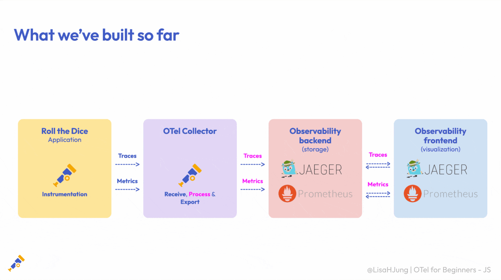

So far, we've covered two signals, traces and metrics. For each one, we instrumented our app, set up the OTel Collector to receive, process, and export the data, and then explored it in a backend.

Now it's time for our third signal, **logs**.

## What is a log?

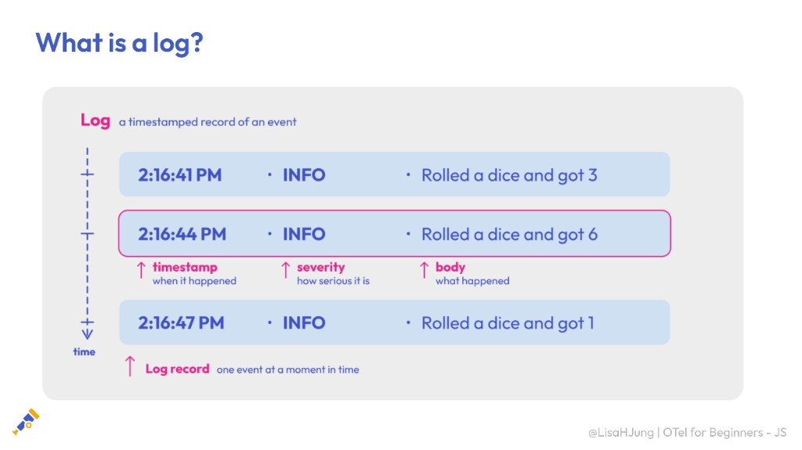

**Logs** are records of events that happen in our app. If you've ever debugged an app by reading through its output, you've already worked with logs.

Each row in this example is a single log, called a **log record**. It describes one event at a specific moment.

Let's take a closer look at one of them:
- The **timestamp** tells us when it happened.
- The **severity** tells us how serious it is.
- The **body** tells us what happened, in plain text.

Follow the timestamps, and you can see what our app did, one event at a time.

This is what sets logs apart from the other two signals.

A **trace** follows the path of a single request. **Metrics** give us the bigger picture across all requests. **Logs** tell us exactly what happened at a specific moment.

## The bare-bones setup

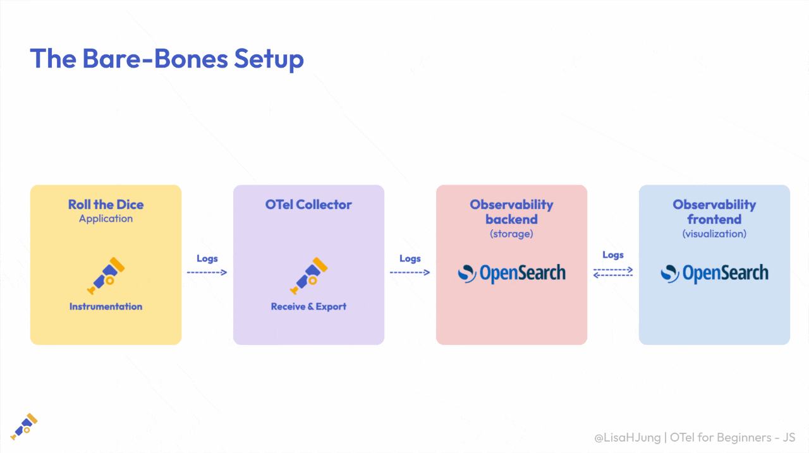

As with traces and metrics, we're starting small.

We'll configure a bare-bones OTel Collector to receive logs and export them to **OpenSearch**, the backend we'll use to store and search our logs. We'll explore them in **OpenSearch Dashboards**.

This setup lets us see our logs exactly as our app sends them. Once we know what they look like, the next episode adds processors to transform them before they're exported.

## Run the learning environment

If you've been following along, you should still have two terminals open. One for the Roll the Dice app and one for Docker.

In each one, we'll stop what's running and move to the `logs/bare-bones-setup` folder. It contains everything this episode needs, including the instrumentation, the Collector configuration, and a Docker setup that now includes OpenSearch and OpenSearch Dashboards.

**Terminal 1: restart the app**

> First, press **Ctrl + C** to stop the running app.

```bash
cd ../../logs/bare-bones-setup
npm install
npm start
```

**Terminal 2: restart the stack, now with OpenSearch**

> First, press **Ctrl + C** to stop the running Docker Compose session.

```bash
docker compose down
cd ../../logs/bare-bones-setup
docker compose up
```

> **Starting fresh?** From the directory where you cloned the repo, run `cd opentelemetry-for-beginners/javascript/logs/bare-bones-setup` in each terminal instead. Then run `npm install` and `npm start` in one, and `docker compose up` in the other.

**Generate some logs**

Once everything is running, head back to the Roll the Dice app at http://localhost:8080/rolldice and refresh the page a few times. Every roll creates a log record.

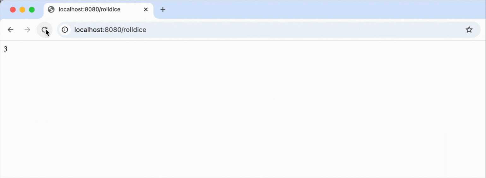

While you refresh, keep an eye on the terminal running Docker. That's where the Collector prints the logs it receives.

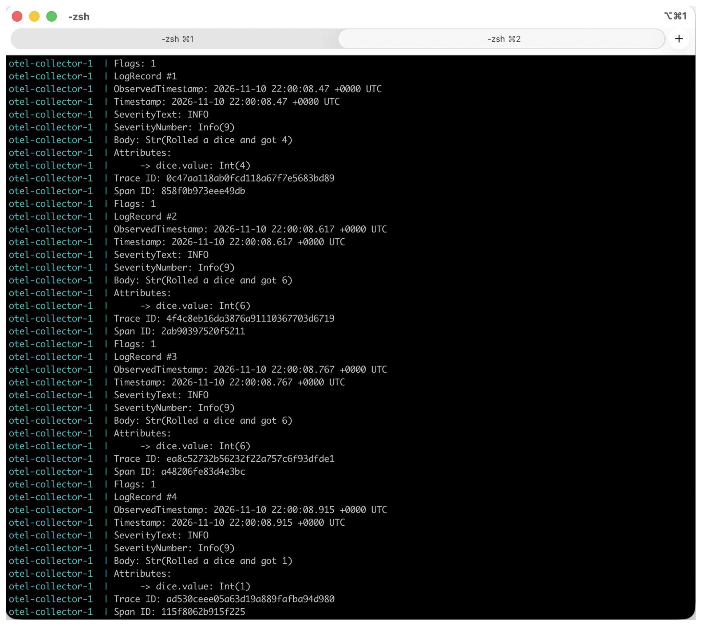

Our logs are batched before they're sent, so it may take a moment for them to appear. Once they do, they're easy to miss, because each log takes up much less space than the metrics output.

**Filter the Collector output**

To make our logs easier to spot, we can filter the Collector output down to just the log records.

Our other two terminals are busy running the app and Docker, so open a third terminal, move into the same `logs/bare-bones-setup` folder, and run this command.

**Terminal 3: show only the log records**

```bash
docker compose logs otel-collector -f | grep --line-buffered -A8 "LogRecord #"
```

Roll the dice a few more times, and each new log record shows up on its own.

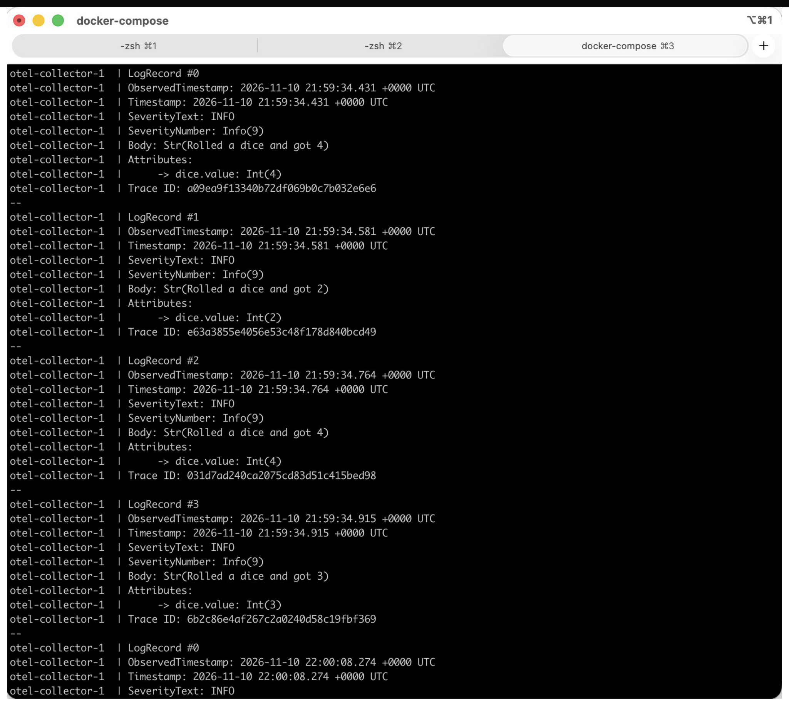

> **Tip:** Run `docker compose` commands from the `logs/bare-bones-setup` folder. From any other folder, Docker Compose won't find this stack's containers.

Our app is creating logs, and the Collector is receiving them. Next, let's dig into the code that makes it happen.

> **Quick heads-up.** To keep things easy to follow, some of the code snippets below only show the logs-related bits. Your actual files also include the traces and metrics setup from the earlier episodes, in `instrumentation.js` and the Collector config. We've just trimmed it out here so it's easier to focus on logs.

## The OTel packages

Open the `javascript/logs/bare-bones-setup` folder in your code editor, then open `package.json`.

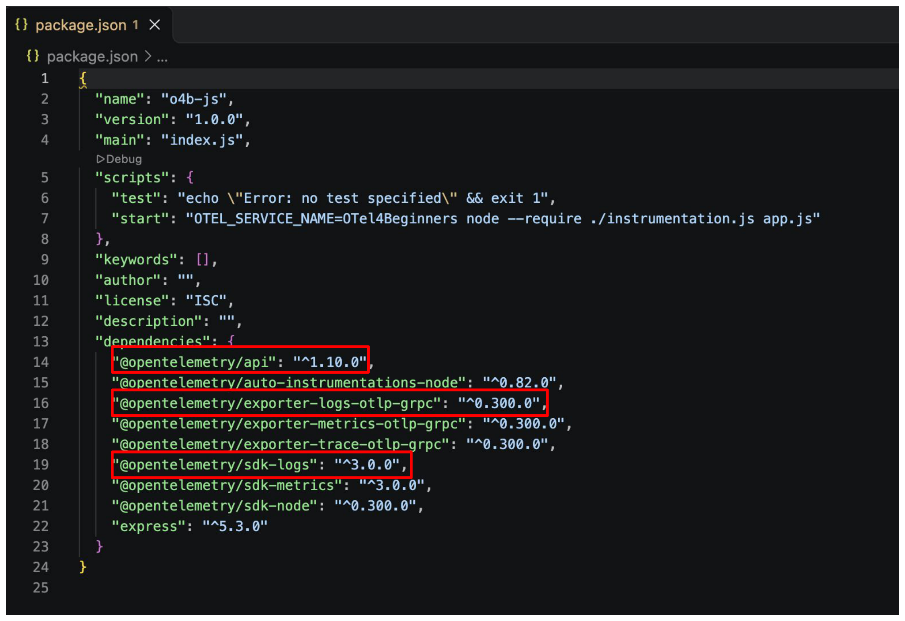

You'll recognize most of these packages from the earlier episodes. Three are new, and all three are there for logs:

- **`@opentelemetry/api`** is the OpenTelemetry API. It lets our app create log records in our code.
- **`@opentelemetry/sdk-logs`** is the Logs SDK. It collects those records and prepares them for export.
- **`@opentelemetry/exporter-logs-otlp-grpc`** is the OTLP log exporter. It sends those records to the Collector over gRPC.

> **Why didn't we need the API before?** In the traces and metrics episodes, auto-instrumentation did all the work, and our own code never called OpenTelemetry directly. The API was still installed, because the SDK and auto-instrumentation packages depend on it, but we didn't have to list it ourselves. Logs is the first time our own code uses the API, so we add it to `package.json`. The same package also includes the APIs for traces and metrics.

To see how these fit together, open `instrumentation.js`.

## instrumentation.js

This file should look familiar from our traces and metrics setup, with the logs pieces added.

```js
const opentelemetry = require('@opentelemetry/sdk-node');

const {
  getNodeAutoInstrumentations,
} = require('@opentelemetry/auto-instrumentations-node');

const {
  OTLPLogExporter,
} = require('@opentelemetry/exporter-logs-otlp-grpc');

const {
  BatchLogRecordProcessor,
} = require('@opentelemetry/sdk-logs');

const sdk = new opentelemetry.NodeSDK({
  // ...trace and metric configuration from the earlier episodes...
  logRecordProcessors: [
    new BatchLogRecordProcessor({
      exporter: new OTLPLogExporter({
        url: 'http://localhost:4317',
      }),
    }),
  ],
  instrumentations: [
    getNodeAutoInstrumentations({
      '@opentelemetry/instrumentation-router': { enabled: false },
    }),
  ],
});

sdk.start();
```

It does four main things:

1. **Imports the packages we need.**
   - Along with the OTel SDK and auto-instrumentation, we bring in the OTLP log exporter and the batch log record processor from the Logs SDK.
2. **Creates a Node SDK instance.**
3. **Exports our logs** to the Collector.
   - This is what's new. We add the batch log record processor and give it the log exporter to use.
   - The processor groups our logs into batches, and the exporter sends them to the Collector on port `4317`, the same port our traces and metrics use.
   - That's why our logs showed up in small groups after a short delay.
4. **Starts the SDK** so our app can generate and send logs.

> **Not the same as the Collector's processors and exporters.** The batch log record processor and the log exporter both run inside our app. They're separate from the processors and exporters we configure in the Collector.

The biggest change this time isn't in our setup files. It's in our app code.

## app.js

So far, we've relied on auto-instrumentation, meaning we haven't had to make any changes to our application code.

With logs, that changes. Our app doesn't use a logging library that OTel can instrument automatically.

So instead, we create our logs directly with the OpenTelemetry Logs API, which comes from the API package we saw in `package.json`.

```js
const { logs, SeverityNumber } = require('@opentelemetry/api');

const logger = logs.getLogger('rolldice-app');

app.get('/rolldice', (req, res) => {
  const roll = getRandomNumber(1, 6);

  logger.emit({
    severityNumber: SeverityNumber.INFO,
    severityText: 'INFO',
    body: `Rolled a dice and got ${roll}`,
    attributes: { 'dice.value': roll },
  });

  res.send(roll.toString());
});
```

Each roll calls `logger.emit()`, which creates a log record with three pieces of information:
- a **severity** of `INFO`, marking the roll as a routine event.
- a **body**, like `Rolled a dice and got 4`. This is the human-readable message we'll see in OpenSearch.
- a **`dice.value` attribute** that holds the rolled number in a field of its own, which makes it easy to search and filter by.

Right now, a one and a six get the same `INFO` severity. Keep that in mind, because it comes back in the next episode.

Writing telemetry in our own code like this is called **manual instrumentation**. It's how we capture the events that matter to our app when auto-instrumentation can't.

With our logs created and on their way, let's follow them into the Collector.

## Collector configuration

In your code editor, open `otel/otel-collector-config.yaml`.

```yaml
# otel/otel-collector-config.yaml
receivers:
  otlp:
    protocols:
      grpc:
        endpoint: 0.0.0.0:4317
      http:
        endpoint: 0.0.0.0:4318

exporters:
  debug:
    verbosity: detailed

  otlp_grpc/jaeger:
    endpoint: jaeger:4317
    tls:
      insecure: true

  prometheus:
    endpoint: 0.0.0.0:8889

  opensearch:
    http:
      endpoint: http://opensearch:9200
    logs_index: otel-logs

service:
  pipelines:
    traces:
      receivers: [otlp]
      exporters: [debug, otlp_grpc/jaeger]
    metrics:
      receivers: [otlp]
      exporters: [debug, prometheus]
    logs:
      receivers: [otlp]
      exporters: [debug, opensearch]
```

We're keeping this configuration bare-bones, so it only has receivers, exporters, and service pipelines. The processors and exporter batching from the earlier processing episodes come back in the next episode.

Our `otlp` receiver is the same one from earlier, so we'll skip ahead to the exporters and then the logs pipeline.

### Exporters

```yaml
# otel/otel-collector-config.yaml
exporters:
  debug:
    verbosity: detailed

  # ...otlp_grpc/jaeger and prometheus exporters from the earlier episodes...

  opensearch:
    http:
      endpoint: http://opensearch:9200
    logs_index: otel-logs
```

Exporters decide where the Collector sends our telemetry. For logs, we're using two of them.

- The **`debug`** exporter is the same one we used for traces and metrics. 
  - This time, it prints our logs to the Collector's output, so we can verify they're making it through.
- The **`opensearch`** exporter is the new addition.
  - For traces, we exported to Jaeger. For metrics, we exported to Prometheus. This time, we're sending our logs to OpenSearch, our backend for storing and searching logs.
  - It writes our logs to an index called `otel-logs`. We'll cover what an index is in just a bit.
  - OpenSearch Dashboards then reads from that index, so we can browse our logs.

### Service

```yaml
# otel/otel-collector-config.yaml
service:
  pipelines:
    logs:
      receivers: [otlp]
      exporters: [debug, opensearch]
```

Defining a receiver or exporter isn't enough to turn it on. A component only runs once we list it in a pipeline in the `service` section, which is where we wire up how data moves through the Collector.

Let's follow a log through our logs pipeline.

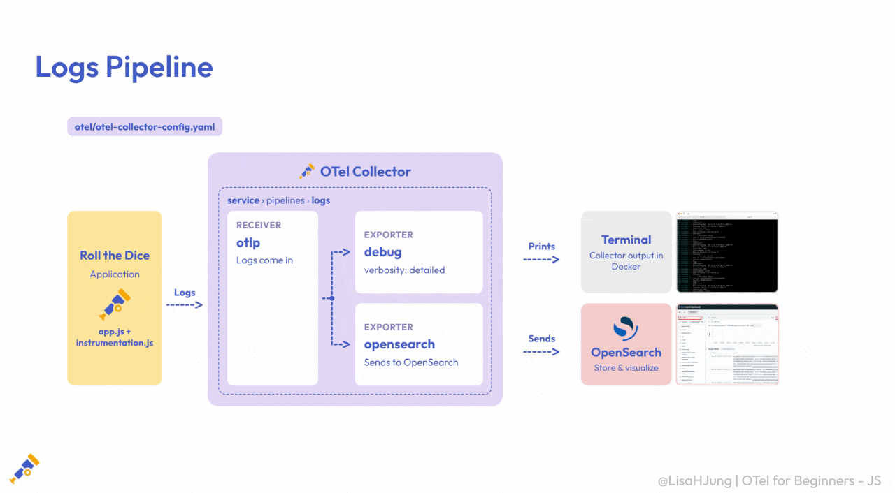

- A dice roll creates a log record, and our app sends it to the Collector.
- The **`otlp`** receiver accepts it and passes it to both exporters at the same time.
- The **`debug`** exporter prints it out, which is what we saw scrolling by in the Docker terminal.
- The **`opensearch`** exporter stores it in OpenSearch, ready for us to search.

That's the whole trip from our app to OpenSearch. Let's go find our logs!

## Explore our logs in OpenSearch Dashboards

**1. Open OpenSearch Dashboards**

Go to http://localhost:5601.

The first time you open it, you might see a pop-up about a new Discover experience. 

If you do, click **Dismiss**. Then, on the welcome screen, click **Explore on my own**.

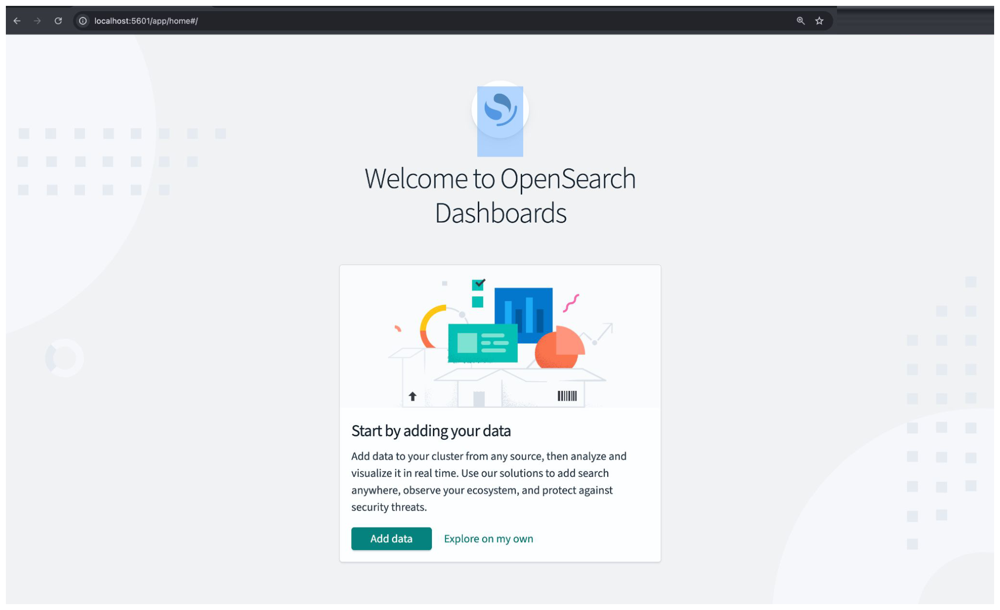

You'll land on the home page.

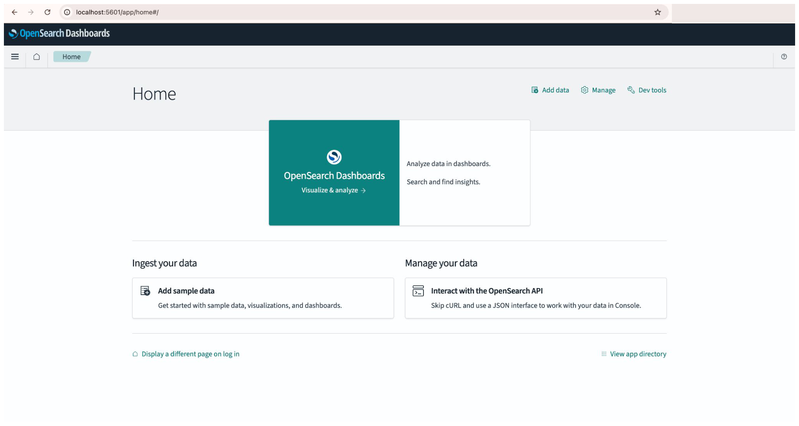

Our logs are already stored in OpenSearch, but we need one quick setup step before we can browse them.

### What's an index?

Remember the `logs_index` setting in our Collector config?

```yaml
# otel/otel-collector-config.yaml
exporters:
  opensearch:
    http:
      endpoint: http://opensearch:9200
    logs_index: otel-logs
```

Because `logs_index` is set to `otel-logs`, the Collector stores all our logs together under that name. OpenSearch calls this an **index**.

You can picture an index as a folder that holds related data, so it's easy to find later.

OpenSearch can hold many indexes, so OpenSearch Dashboards needs us to point it at the one we care about.

### What's an index pattern?

That's the job of an **index pattern**. It tells OpenSearch Dashboards which indexes to read from. We'll create one for `otel-logs`.

**2. Create the index pattern**

1. From the home page, click **Manage** in the top-right corner.

   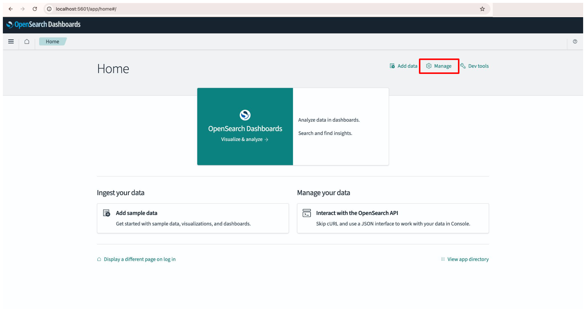

2. From the menu on the left, select **Index patterns**.

   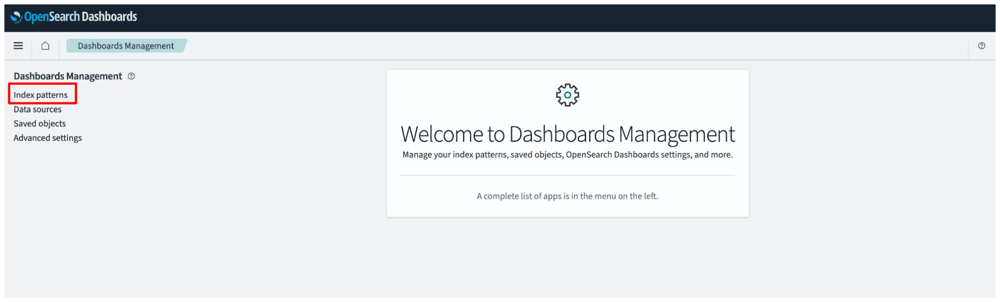

3. Click **Create index pattern**.

   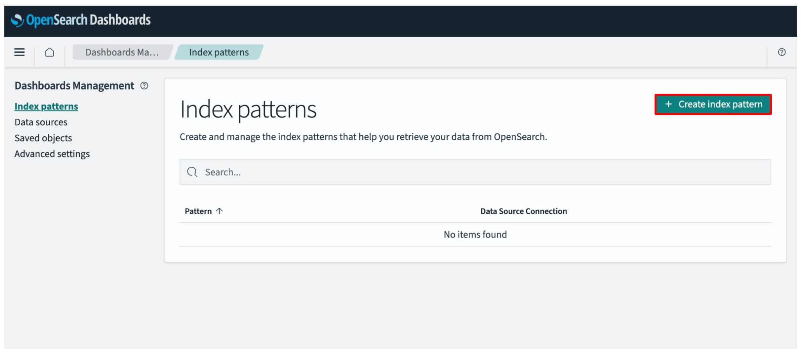

4. For the index pattern name, enter `otel-logs`. You'll see it match our `otel-logs` index below. Then click **Next step**.

   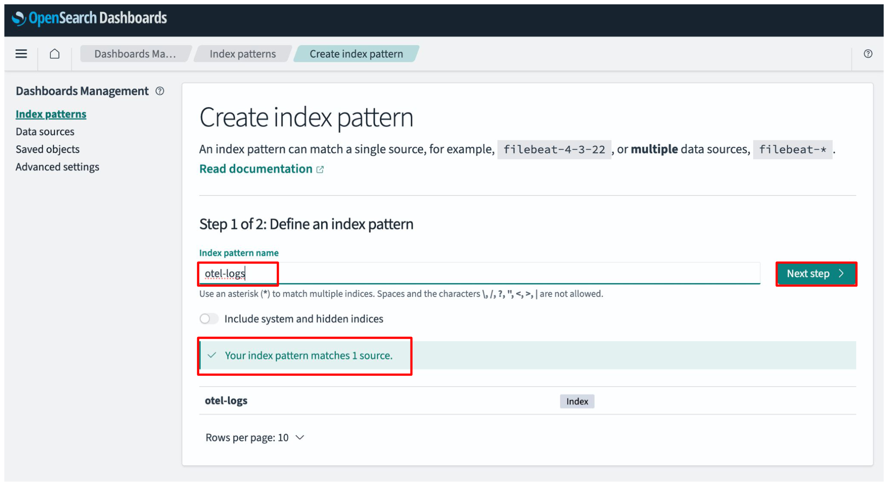

   > OpenSearch Dashboards adds an asterisk for you, so the pattern is saved as `otel-logs*`. It still matches only our `otel-logs` index.

5. Open the time field dropdown. 

  You'll see two options. Pick `@timestamp`, which is when the event happened in our app. That way, our logs appear on the timeline based on when we actually rolled the dice. Then click **Create index pattern**.

   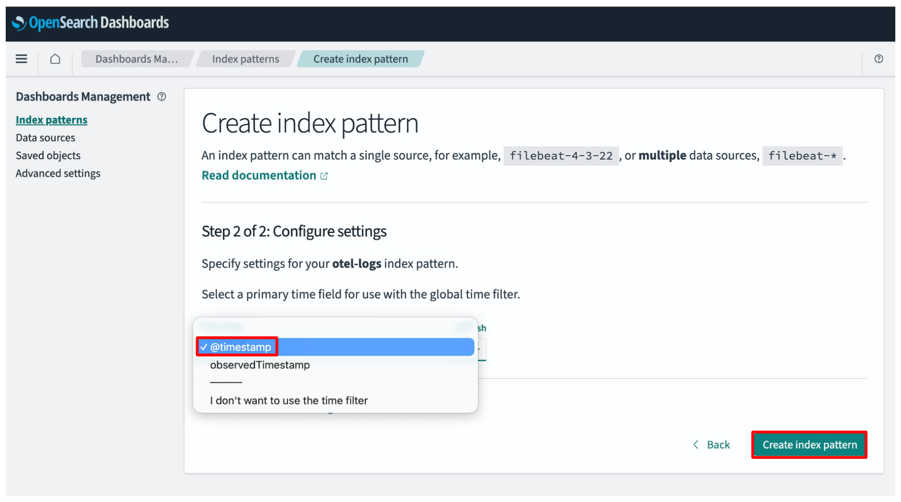

**3. View our logs in Discover**

1. Open the menu in the top-left corner and select **Discover**.

   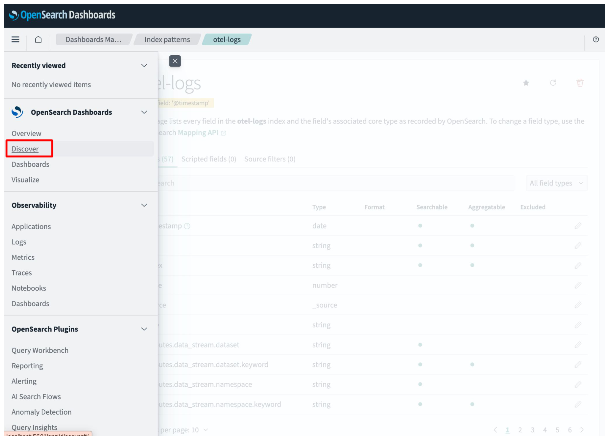

2. Make sure `otel-logs*` is selected in the dropdown near the top-left.
3. Our app only generates logs when we roll the dice. Head back to the Roll the Dice app and roll a few times.

   

4. Come back to **Discover**, set the time range to **Last 15 minutes**, and click **Refresh**.

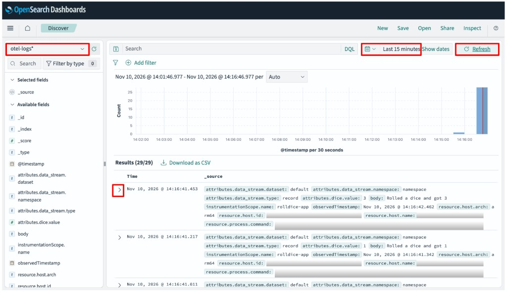

> **No results?** Give it a few seconds for the batch to come through, then click **Refresh** again. Also check the time range. With **Last 15 minutes**, logs older than 15 minutes drop out of view, so roll a few more times or pick a longer range.

You should now see your log records, with the newest at the top. Let's expand one by clicking the arrow at the start of its row and take a closer look.

### Inside a log record

**The body and attributes**

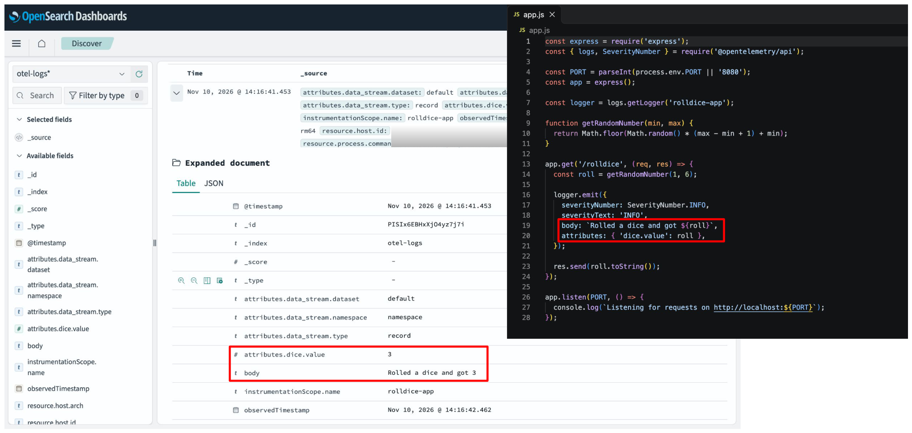

Remember the body and the `dice.value` attribute we set in `app.js`? Both made it through the Collector, and here they are in OpenSearch.

- **`body`** contains the message we created in our code, like `Rolled a dice and got 3`.
- **`attributes.dice.value`**, right above it, captures the value we rolled as an attribute.

They work as a pair. The body describes the event in words, and the attribute stores the key detail as data we can filter on.

> You'll also see a few `attributes.data_stream` fields. The OpenSearch exporter adds those when it writes our logs, so they don't come from our code.

**Resource attributes**

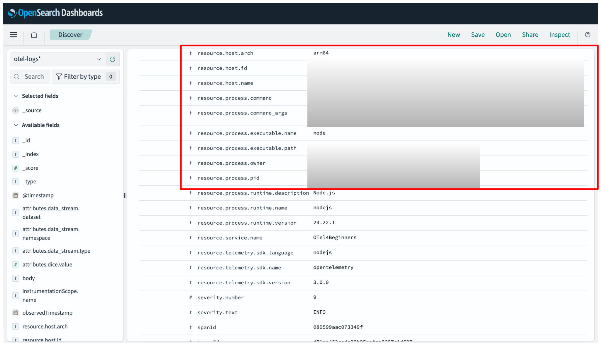

Scroll down a bit, and you'll find a group of fields that start with `resource`. These are our **resource attributes**, just like the ones we saw with [traces](../traces/README.md#process-resource-attributes) and [metrics](../metrics/README.md#resource-attributes).

They describe where a log came from, such as our app, the process running it, and the host. All our logs come from the same app instance, so these values are identical on every log, while `dice.value` changes from roll to roll.

Many of these details were added for us automatically. Some are handy to have, like `service.name`. Others are more than we need for this demo, like host identifiers, the process owner, and the command used to start our app.

In the next episode, we'll use processors to remove these:
- `host.arch`
- `host.id`
- `host.name`
- `process.command`
- `process.command_args`
- `process.executable.path`
- `process.owner`
- `process.pid`

**Severity**

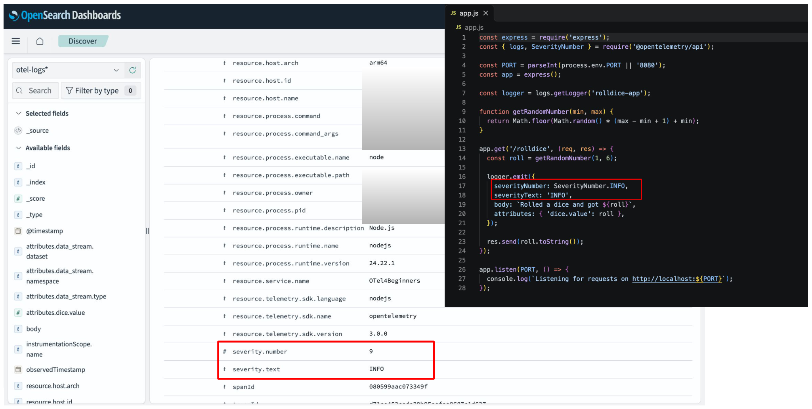

Keep scrolling to reach the **severity** fields, which show how important an event is.

These come straight from `app.js`. Our rolls are routine, so we set `severityNumber` to `SeverityNumber.INFO` and `severityText` to `'INFO'` in `logger.emit()`. In OpenSearch, they show up as `severity.number` and `severity.text`.

`severity.text` reads `INFO`, and `severity.number` is `9`. Don't mistake that `9` for a dice roll! It's OpenTelemetry's numeric code for `INFO`.

Next episode, our rolls get different severity levels, and we'll use those levels to choose which logs to keep.

**Trace context**

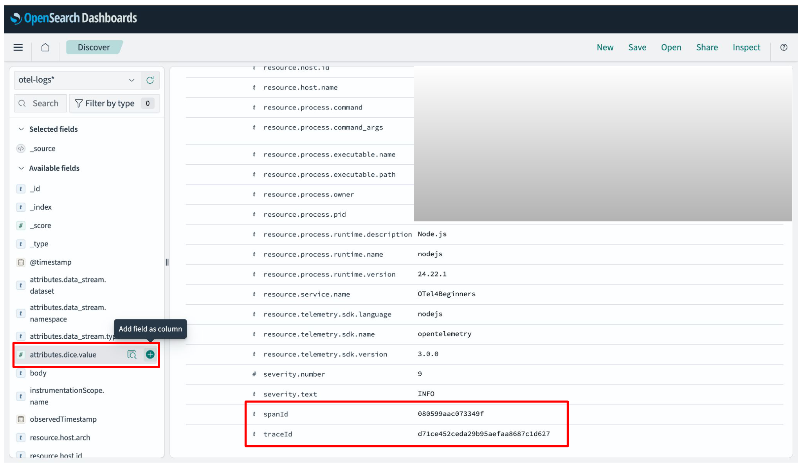

Finally, at the bottom of the record is the **trace context**, a `traceId` and a `spanId`. Notice that we never added these in our code.

Because this log was created during a traced request, OpenTelemetry attached them for us. 

The `traceId` connects this log to that request's trace. If we need more context about what happened, we can search for that trace ID in Jaeger and follow the request from start to finish.

So far, we've been looking at one log at a time. To compare several logs at a glance, we can turn fields into columns.

In the **Available fields** menu on the left, hover over `attributes.dice.value` and `severity.text`, and click the **Add field as column** button next to each one.

### Compare several logs at once
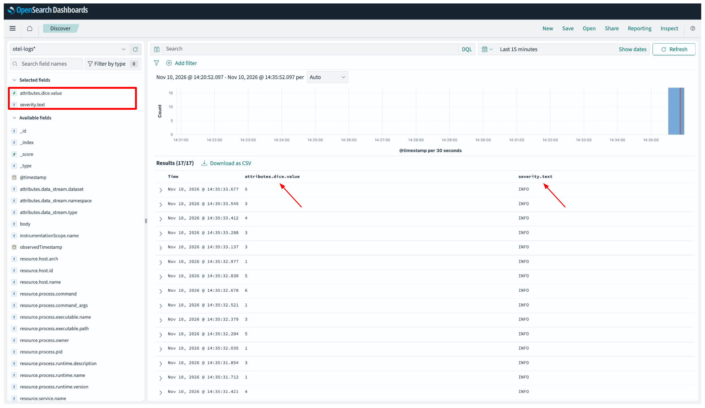

Now every row shows its dice value and severity right in the table. This view comes in handy next episode, when we compare our logs before and after processing.

And just like that, our logs pipeline is up and running!


In this episode, we wrote our first manual instrumentation with the OpenTelemetry Logs API, sent our logs through a bare-bones Collector, and explored them in OpenSearch Dashboards. 

Along the way, we unpacked a log record, from its body and attributes to its resource attributes, severity, and trace context.

Our logs are flowing, but they're still raw. 

In the next episode, processors are back, and we'll use them to clean up, enrich, and filter our logs before they leave the Collector.

# Episode 8 - Processing Logs: OpenTelemetry Collector in Action

In the last episode, we got our bare-bones logs pipeline up and running. Our app generated logs, the Collector exported them to OpenSearch, and we explored them in OpenSearch Dashboards.

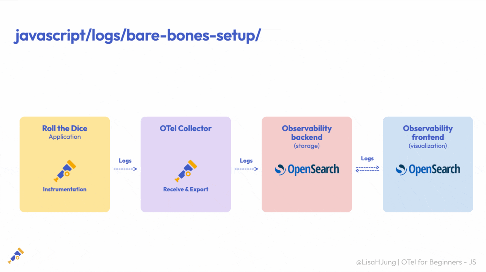

As we looked through those logs, a few things stood out that we could improve.

Our logs carried host and process details we don't really need. Every roll also came through with the same `INFO` severity, whether we rolled a one or a six.

And we were storing every single roll, even though we might not need all of them.

That's where **processors** come in.

If you followed along with the traces and metrics episodes, processors should look familiar. They run inside the OTel Collector and let us modify, enrich, and filter our telemetry before it's exported. 

This time, we'll put them to work on our logs.

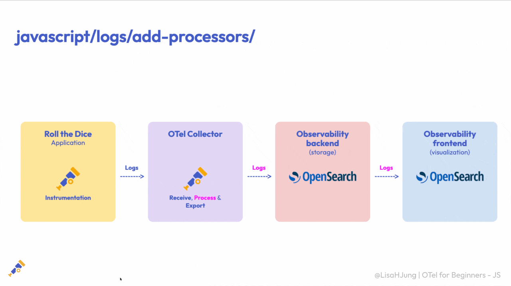

In this episode, we'll:
1. **Clean up** the resource attributes we don't need.
2. **Enrich** our logs by giving some of our dice rolls a different severity.
3. **Filter** our logs, using those severity levels to decide which ones to keep.

Let's get everything ready.

## Run the learning environment locally

If you've been following along from the last episode, you should already have two terminals open.
One is running the Roll the Dice app and the other is running Docker. We'll reuse both.

If you still have the third terminal open with the filtered Collector output, go ahead and stop it with `Ctrl + C`.

In the first two terminals, stop what's running, move into the `logs/add-processors` folder, and start everything back up.

**Terminal 1: restart the app**

> First, press **Ctrl + C** to stop the running app.

```bash
cd ../add-processors
npm install
npm start
```

**Terminal 2: restart the Collector, Jaeger, Prometheus, and OpenSearch**

> First, press **Ctrl + C** to stop the running Docker Compose session.

```bash
docker compose down
cd ../add-processors
docker compose up
```

Once everything is running, we're ready to generate some logs.

In your browser, go to http://localhost:8080/rolldice and refresh the page a few times to roll the dice.


Now that our logs are flowing, let's take a look at the configuration that's processing them.

## New OpenTelemetry Collector Configuration

In your code editor, make sure the `logs/add-processors` folder is open. Then head into the `otel` directory and open `otel-collector-config.yaml`.

In our bare-bones setup, our configuration had three main parts: receivers, exporters, and service pipelines. 

This time, there's a fourth, **processors**.

You'll notice this config has pipelines for traces, metrics, and logs, and some of the processors are shared across them. 
For this episode, we'll focus on the logs pipeline.

> **Quick heads-up.** Just like in the last episode, the snippet below only shows the logs-related bits. Your actual file also includes the traces and metrics processors and exporters from the earlier episodes, we've just trimmed them out here so it's easier to focus on logs.

**otel/otel-collector-config.yaml**
```yaml
receivers:
  otlp:
    protocols:
      grpc:
        endpoint: 0.0.0.0:4317
      http:
        endpoint: 0.0.0.0:4318

processors:
  resource:
    attributes:
      - key: deployment.environment.name
        value: local
        action: insert
      - key: host.arch
        action: delete
      - key: host.id
        action: delete
      - key: host.name
        action: delete
      - key: process.command
        action: delete
      - key: process.command_args
        action: delete
      - key: process.executable.path
        action: delete
      - key: process.owner
        action: delete
      - key: process.pid
        action: delete

  transform/logs:
    log_statements:
      - set(log.severity_number, SEVERITY_NUMBER_WARN) where log.attributes["dice.value"] == 1
      - set(log.severity_text, "WARN") where log.attributes["dice.value"] == 1

  filter/logs:
    log_conditions:
      - 'log.severity_number < SEVERITY_NUMBER_WARN'

exporters:
  debug:
    verbosity: detailed

  opensearch:
    http:
      endpoint: http://opensearch:9200
    logs_index: otel-logs
    sending_queue:
      sizer: items
      batch:
        flush_timeout: 5s
        min_size: 512

service:
  pipelines:
    logs:
      receivers: [otlp]
      processors: [resource, transform/logs, filter/logs]
      exporters: [debug, opensearch]
```

Our logs pipeline uses three processors: `resource`, `transform`, and `filter`. Let's walk through them one at a time.

## 1. The `resource` processor

**The `resource` processor modifies the resource attributes that describe where our telemetry came from.**

We've already used this one in our traces and metrics episodes.

**otel/otel-collector-config.yaml**
```yaml
processors:
  resource:
    attributes:
      - key: deployment.environment.name
        value: local
        action: insert
      - key: host.arch
        action: delete
      - key: host.id
        action: delete
      - key: host.name
        action: delete
      - key: process.command
        action: delete
      - key: process.command_args
        action: delete
      - key: process.executable.path
        action: delete
      - key: process.owner
        action: delete
      - key: process.pid
        action: delete
```

In our config, it does two things:
- It **inserts** `deployment.environment.name` and sets it to `local`, so we can tell at a glance which environment our telemetry came from.
- It **deletes** the host and process details we spotted in the last episode, like `host.id`, `process.owner`, and the command used to start our app.

The same `resource` processor is shared across our traces, metrics, and logs pipelines.

**Follow along in OpenSearch Dashboards**

Want to see these changes on your own setup? 

Open OpenSearch Dashboards at http://localhost:5601 and head to **Discover**.

If you need to recreate the `otel-logs` index pattern, follow the same steps from the last episode, using `otel-logs` for the name and `@timestamp` for the time field. Then expand a log record, and you'll be able to spot the changes for yourself.

For each processor, we'll compare our logs from the bare-bones setup (**before**) with our processed logs (**after**).

**Before: logs from the bare-bones setup**

Remember all those `resource.host` and `resource.process` attributes we saw when we expanded a log in the last episode?


**After: logs from the new Collector configuration**

Now let's compare that with our processed logs. Here, the before and after views are side by side so it's easy to see what changed.


On the left are our original logs, with all those host and process details.

On the right, after applying the `resource` processor, those details are gone. In their place, we have a new resource attribute, `deployment.environment.name`, set to `local`.

With just one processor, we've removed the details we don't need and added the context we do.

## 2. The `transform` processor

**The `transform` processor modifies the log records themselves.**

While the `resource` processor works on where our telemetry came from, the `transform` processor lets us change different parts of each log record.

It uses the **OpenTelemetry Transformation Language**, or **OTTL**, to describe the changes we want to make.

We won't dive into OTTL itself in this series, but we'll see an example of what it can do. If you'd like to learn more, check out the [Transform processor (OTTL)](https://github.com/open-telemetry/opentelemetry-collector-contrib/tree/main/processor/transformprocessor) link in the [Resources](#resources) section.

**otel/otel-collector-config.yaml**
```yaml
processors:
  transform/logs:
    log_statements:
      - set(log.severity_number, SEVERITY_NUMBER_WARN) where log.attributes["dice.value"] == 1
      - set(log.severity_text, "WARN") where log.attributes["dice.value"] == 1
```

In our example, we're going to change the **severity** of some of our logs.

Let's pretend that rolling a one is something we want to flag. Whenever `dice.value` is `1`, these two statements raise the severity from `INFO` to `WARN`:
- severity_number becomes SEVERITY_NUMBER_WARN. 
OpenTelemetry represents WARN with the number 13, so that's what you'll see as severity.number in Discover, just like INFO showed up as 9 in the last episode.
- `severity_text` becomes `WARN`.

Flagging those rolls helps them stand out from the rest, and it sets us up to decide which logs to keep in the next step.

Of course, in a real application, what we flag depends on what matters for our use case.

Now let's see what this looks like in Discover.

**Before: logs from the bare-bones setup**

Here, the dice value and severity are shown side by side. Notice that every roll, from one through six, came through with the same `INFO` severity.


**After: logs from the new Collector configuration**

To compare, let's set up the same view on our live dashboard that we used in the last episode.

Under **Available fields** on the left, find `attributes.dice.value` and `severity.text` and click **Add** for each. Now every row shows the roll next to its severity.


Let's expand one of the records and scroll down to `attributes.dice.value`.


Remember, in our bare-bones setup, every roll came through as `INFO`, including the ones.

Now, the dice value is `1` and the severity is `WARN`. That's our `transform` processor at work, changing the severity exactly as we configured it.

Now let's close this record and take a look at the rest of our logs.


Here's where things get interesting. Every log record we're seeing has a dice value of one.

It's pretty unlikely that we rolled a one every single time. 

So what happened to all the other rolls? That's where our next processor comes in.

## 3. The `filter` processor

**The `filter` processor drops the telemetry we don't need before it's exported.**

Not every log needs to be stored. As the amount of log data grows, keeping only what we need can save storage and make our logging setup more cost-efficient.

**otel/otel-collector-config.yaml**
```yaml
processors:
  filter/logs:
    log_conditions:
      - 'log.severity_number < SEVERITY_NUMBER_WARN'
```

The `filter` processor drops any log record that matches its condition. 

In our example, that's anything with a severity below `WARN`. Since our rolls of one are now `WARN` and the rest are still `INFO`, only the ones make it through.

Let's see the difference in OpenSearch.

**Before: logs from the bare-bones setup**

Every roll made it to OpenSearch, from one through six. At the top, we can also see the total number of log records.


**After: logs from the new Collector configuration**

Take a look at the results count. We have far fewer records than before.

And notice what's left. Every dice value is `1`, and every severity is `WARN`.


By combining the `transform` and `filter` processors, we can flag the events we care about and filter out the rest before they're stored.

## Batching at the exporter

Now that we've covered our processors, let's scroll down to the exporters.

**Exporters send telemetry from the Collector to our backends.**

There's one change here worth pointing out, and it has to do with **batching**.
Before we get into it, let's revisit the batching we saw in the last episode.

**Batching in the app**

Remember `instrumentation.js`? Our app uses a `BatchLogRecordProcessor` to group logs together before sending them to the Collector.

That batching happens at the app level, before our logs ever reach the Collector.

**instrumentation.js**
```js
logRecordProcessors: [
  new BatchLogRecordProcessor(
    new OTLPLogExporter({
      url: 'http://localhost:4317',
    }),
  ),
],
```

**Batching in the Collector**

Back in our Collector config, we're looking at batching at a different point in the pipeline, right before the Collector sends telemetry to a backend.

Remember our metrics setup? Prometheus **pulls** metrics from the Collector, so we don't use batching in that pipeline.

Logs and traces work a little differently. Our OpenSearch and Jaeger exporters **push** telemetry to their backends, so sending records in batches helps make that more efficient.

Let's take a look at our OpenSearch exporter.

**otel/otel-collector-config.yaml**
```yaml
exporters:
  opensearch:
    http:
      endpoint: http://opensearch:9200
    logs_index: otel-logs
    sending_queue:
      sizer: items
      batch:
        flush_timeout: 5s
        min_size: 512
```

We already covered `endpoint` and `logs_index` in the last episode. They tell the Collector where to send our logs and which index to write them to.

What's new here is the **`sending_queue`**, which lets the exporter send our logs in batches:
- `sizer: items` tells the exporter to measure batch size by the number of log records.
- `batch.min_size: 512` sends a batch once it reaches 512 log records.
- `batch.flush_timeout: 5s` is the longest the exporter waits before sending a batch, even if it isn't full yet.

Whichever comes first, 512 records or 5 seconds, triggers the export.

These values aren't one-size-fits-all, so feel free to adjust them based on your needs.

## The service component ties it all together

**The `service` component defines how data moves through the Collector.**

As we learned earlier, this is where we connect our receivers, processors, and exporters to build our pipeline.

**otel/otel-collector-config.yaml**
```yaml
service:
  pipelines:
    logs:
      receivers: [otlp]
      processors: [resource, transform/logs, filter/logs]
      exporters: [debug, opensearch]
```
- The **`otlp` receiver** accepts logs from our app.
- The **processors** clean up, enrich, and filter them.
- The **`debug` and `opensearch` exporters** print the remaining logs to the terminal and send them to OpenSearch for storage.

**IMPORTANT**

Processors run in the order they're liste. First `resource`, then `transform`, and finally `filter`.

That order is intentional. 

The `transform` processor changes our rolls of one to `WARN`, and then the `filter` processor drops anything below `WARN`.
If we switched that order, every one of those rolls would still be `INFO` when it reached the filter, so they'd all be dropped.

And with that, we've taken our logs pipeline one step further by processing our logs before they're stored.

# What We Built and Where to Go Next

That's a wrap on the OpenTelemetry for Beginners JavaScript Journey!
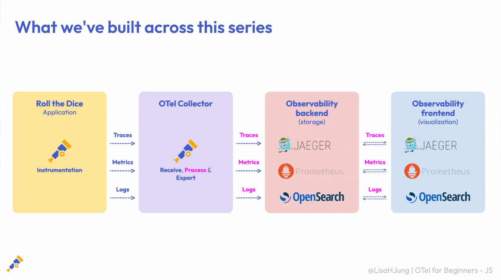

We started by exploring what OpenTelemetry is. Then, one signal at a time, we built pipelines for traces, metrics, and logs.

We instrumented our app, configured the OTel Collector to receive, process, and export our telemetry, and explored our data in a different backend for each signal.

And the best part? 

**Our app never needed to know where its telemetry was going.** 

We chose where to send it through the Collector configuration, without changing a line of application code. 

That flexibility is one of the great things about OpenTelemetry, and it helps us avoid getting locked into a single vendor.

## Where to go from here
- **Try it on your own app.**
  - Instrument one of your own applications and see what its telemetry tells you.
- **Experiment with processors.**
  - The [list of Collector processors](https://github.com/open-telemetry/opentelemetry-collector-contrib/tree/main/processor) is a great place to explore new ways to shape your data.
- **Connect with the community.**
  - If you have questions, the [OpenTelemetry documentation](https://opentelemetry.io/docs/) and the [OpenTelemetry Slack channel](https://opentelemetry.io/community/end-user/slack-channel/) are great places to start.

Thank you so much for following along with me throughout this series. 

I hope you enjoyed it and learned something useful along the way!

## Resources
- [OpenTelemetry documentation](https://opentelemetry.io/docs/)
  - Ask AI (⌘+K shortcut)
  - [Language APIs and SDKs](https://opentelemetry.io/docs/languages/)
  - [Logs](https://opentelemetry.io/docs/concepts/signals/logs/)
  - [OpenTelemetry Collector](https://opentelemetry.io/docs/collector/)
    - [List of OpenTelemetry Collector processors](https://github.com/open-telemetry/opentelemetry-collector-contrib/tree/main/processor)
  - [Transform processor (OTTL)](https://github.com/open-telemetry/opentelemetry-collector-contrib/tree/main/processor/transformprocessor)
- [OpenSearch documentation](https://docs.opensearch.org/)
- [OpenTelemetry YouTube channel](https://www.youtube.com/@otel-official)
  - [OpenTelemetry for Beginners series - The JavaScript Journey](https://youtu.be/iEEIabOha8U?feature=shared)
- [OpenTelemetry Slack channel](https://opentelemetry.io/community/end-user/slack-channel/)
