# OpenTelemetry for Beginners - The JavaScript Journey (Metrics)

Getting started with OpenTelemetry can feel overwhelming, but this beginner series for JavaScript developers will guide you step by step.

This guide covers the **metrics** signal and builds on everything we set up in the [Traces walkthrough](../traces/README.md).

> **New to the series?** Start with the [Traces walkthrough](../traces/README.md). It covers what OpenTelemetry is, the pipelines we'll build, the prerequisites, and how to clone the repo. This guide assumes you've completed those steps and can run the Roll the Dice app.

## Resources
- [OpenTelemetry documentation](https://opentelemetry.io/docs/)
  - Ask AI (⌘+K shortcut)
  - [Language APIs and SDKs](https://opentelemetry.io/docs/languages/)
  - [Instrumentation](https://opentelemetry.io/docs/concepts/instrumentation/)
  - [Metrics](https://opentelemetry.io/docs/concepts/signals/metrics/)
  - [OpenTelemetry Collector](https://opentelemetry.io/docs/collector/)
    - [List of OpenTelemetry Collector processors](https://github.com/open-telemetry/opentelemetry-collector-contrib/tree/main/processor)
- [Prometheus documentation](https://prometheus.io/docs/introduction/overview/)
- [OpenTelemetry YouTube channel](https://www.youtube.com/@otel-official)
  - [OpenTelemetry for Beginners series - The JavaScript Journey](https://youtu.be/iEEIabOha8U?feature=shared)
- [OpenTelemetry Slack channel](https://opentelemetry.io/community/end-user/slack-channel/)

# Episode 5 - Metric Instrumentation & Bare-Bones Collector Configuration

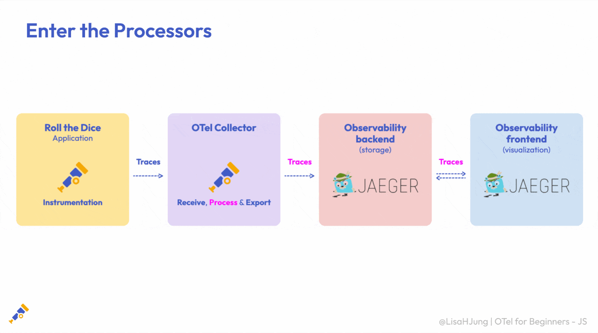

In the previous episodes, we instrumented our app and configured the Collector to receive, process, and export our traces. From there, our traces were stored and visualized in Jaeger.

Now that we've seen how OpenTelemetry works with traces, we'll follow a similar journey with metrics over the next few episodes.

## What is a metric?

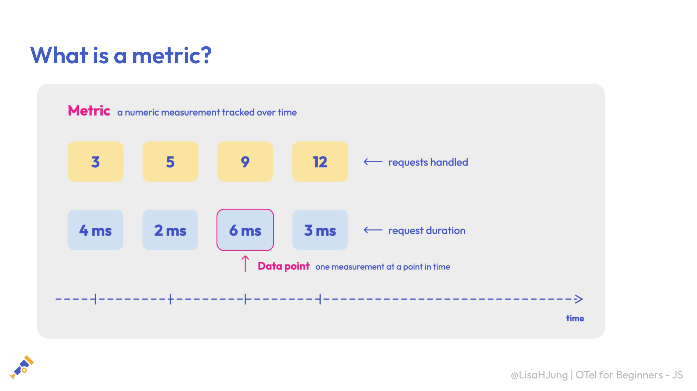

**Metrics** are numbers that tell us how our app behaves over time.

This example shows two metrics, one per row:
- The top row is a running count of the requests our app has handled. It climbs as new requests arrive.
- The bottom row records how long each of those requests took.

Each box is a single value captured at a specific moment, called a **data point**.

Read a row from left to right, and you can watch the values change over time.

This is the key difference between the two signals.

A **trace** shows us what happened during a single request. **Metrics** give us the bigger picture across all requests.

## The bare-bones setup

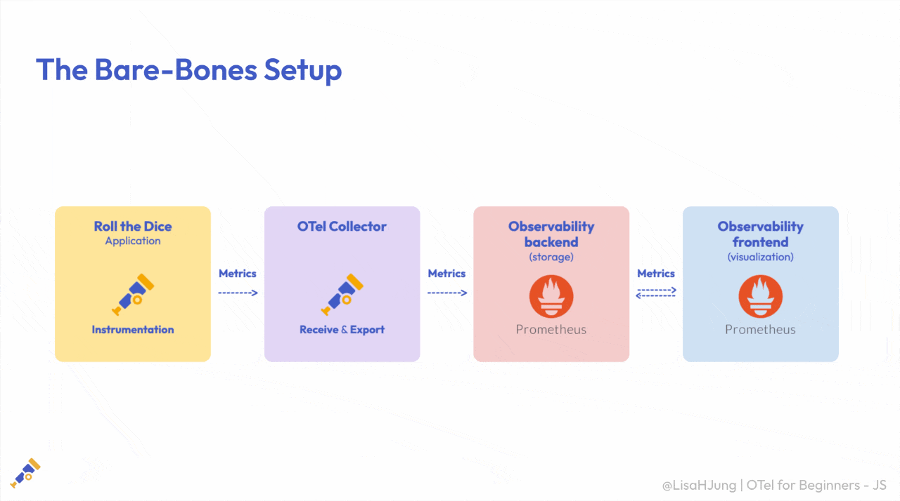

As we did with traces, we'll start simple. 

We'll generate metrics with auto-instrumentation, then configure a bare-bones Collector that receives them and passes them along to **Prometheus**, the backend we'll use to store and explore our metrics.

Before changing anything, we'll explore those metrics in Prometheus to get a feel for what our app collects out of the box.

## Run the learning environment

If you've been following along, you should still have two terminals open. One for the Roll the Dice app and one for Docker.

In each one, we'll stop what's running and move to the `metrics/bare-bones-setup` folder. 

It contains everything this episode needs, including the instrumentation, the Collector configuration, and a Docker setup that now includes Prometheus.

**Terminal 1: restart the app**

> First, press **Ctrl + C** to stop the running app.

```bash
cd ../../metrics/bare-bones-setup
npm install
npm start
```

**Terminal 2: restart the Collector and Jaeger, now with Prometheus**

```bash
docker compose down
cd ../../metrics/bare-bones-setup
docker compose up
```

> **Starting fresh?** From the directory where you cloned the repo, run `cd opentelemetry-for-beginners/javascript/metrics/bare-bones-setup` in each terminal instead. Then run `npm install` and `npm start` in one, and `docker compose up` in the other.

**Generate some metrics**

Once everything is running, head back to the Roll the Dice app at http://localhost:8080/rolldice and refresh the page a few times.

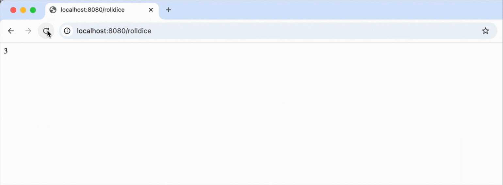

While you refresh, keep an eye on the terminal running Docker. That's where the Collector prints the metrics it receives.

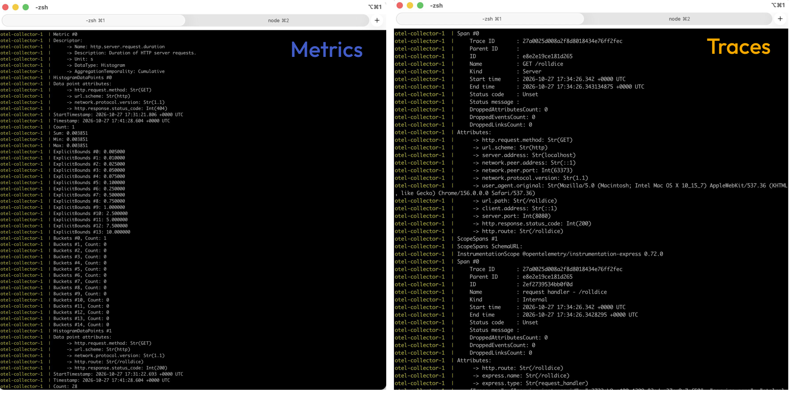

**Metrics**
- Runtime metrics, like memory usage, appear on their own, even before any requests come in.
- HTTP request metrics show up once we start rolling the dice.

**Traces**
- Spans appear here too, because our traces pipeline is still running alongside the new one.

Our app is now sending both traces and metrics to the Collector. 

Next, let's look at the setup that makes the metrics possible.

> **Quick heads-up.** To keep things easy to follow, some of the code snippets below only show the metrics-related bits. Your actual files also include the traces setup from the earlier episodes, in `instrumentation.js` and the Collector config. We've just trimmed it out here so it's easier to focus on metrics.

## The OTel packages

Open the `javascript/metrics/bare-bones-setup` folder in your code editor, then open `package.json`.

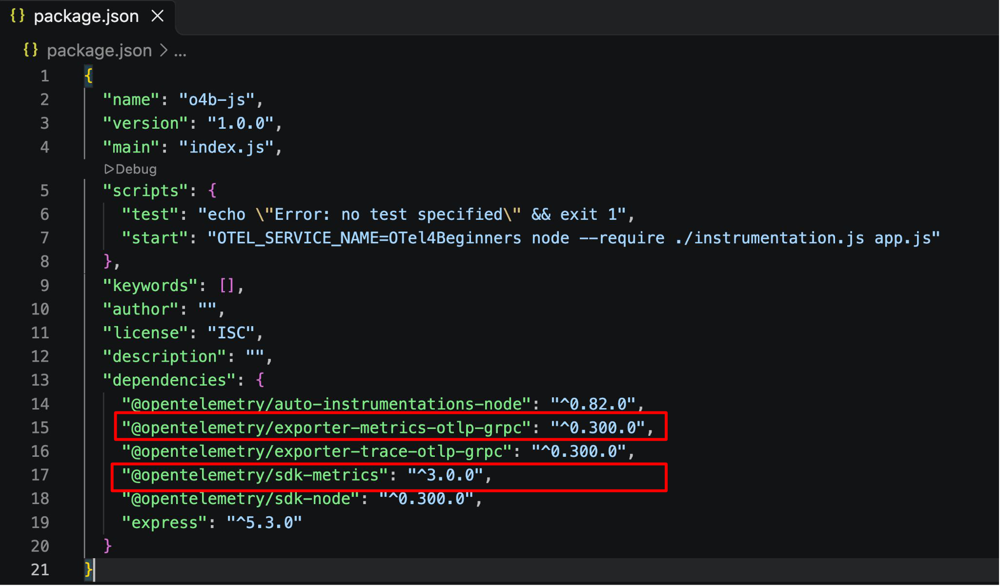

You'll recognize most of these packages from the traces setup. Two are new, and both are there for metrics:

- **`@opentelemetry/sdk-metrics`** is the Metrics SDK. It gathers the metrics our app records.
- **`@opentelemetry/exporter-metrics-otlp-grpc`** is the OTLP metric exporter. It ships those metrics to the Collector over gRPC.

To see how the two fit together, open `instrumentation.js`.

## instrumentation.js

This file should look familiar from the traces setup, with the metrics pieces added.

```js
const opentelemetry = require('@opentelemetry/sdk-node');

const {
  getNodeAutoInstrumentations,
} = require('@opentelemetry/auto-instrumentations-node');

const {
  OTLPMetricExporter,
} = require('@opentelemetry/exporter-metrics-otlp-grpc');

const {
  PeriodicExportingMetricReader,
} = require('@opentelemetry/sdk-metrics');

const sdk = new opentelemetry.NodeSDK({
  // ...trace configuration from the earlier episodes...
  metricReaders: [
    new PeriodicExportingMetricReader({
      exporter: new OTLPMetricExporter({
        url: 'http://localhost:4317',
      }),
      exportIntervalMillis: 10000,
    }),
  ],
  instrumentations: [
    getNodeAutoInstrumentations({
      '@opentelemetry/instrumentation-router': { enabled: false },
    }),
  ],
});

sdk.start();
```

It does four main things:

1. **Imports the packages we need.**
   - Along with the OTel SDK and auto-instrumentation, we bring in the OTLP metric exporter and a metric reader from the Metrics SDK.
2. **Creates a Node SDK instance** and enables auto-instrumentation.
   - No extra setup is needed here. The auto-instrumentation that gave us traces also records metrics, like request duration and memory usage.
3. **Exports our metrics** to the Collector.
   - This is what's new. The metric reader gathers the latest values every ten seconds (`exportIntervalMillis: 10000`) and hands them to the exporter.
   - The exporter then sends them to the Collector on port `4317`, the same port our traces use.
4. **Starts the SDK** so our app can generate and send metrics.

That covers the app side. We've seen how our app generates metrics and sends them to the Collector.

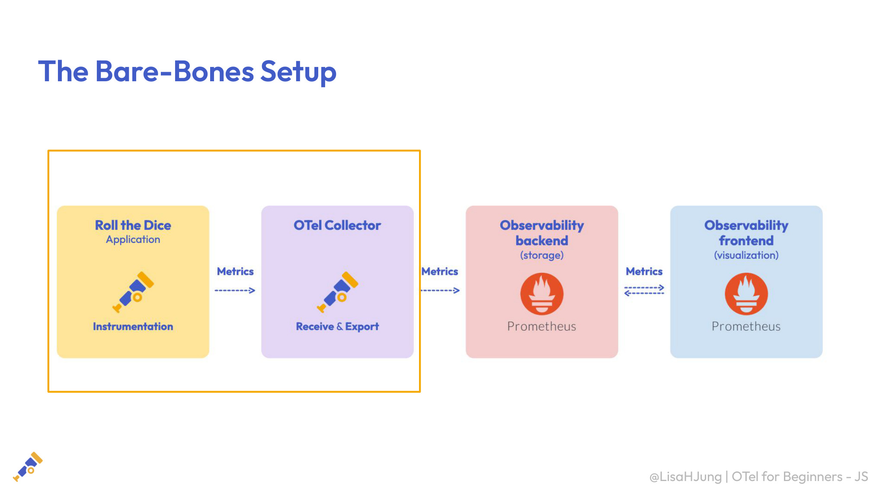

## Collector configuration

Now let's look at the other half of the pipeline, where the Collector takes in those metrics and hands them off to our backend. 

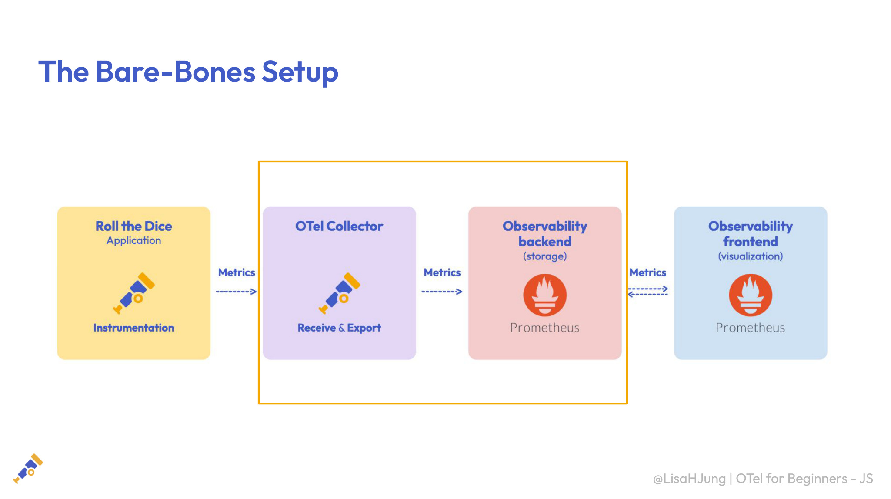

In your code editor, open `otel/otel-collector-config.yaml`.

```yaml
# otel/otel-collector-config.yaml
receivers:
  otlp:
    protocols:
      grpc:
        endpoint: 0.0.0.0:4317
      http:
        endpoint: 0.0.0.0:4318

exporters:
  debug:
    verbosity: detailed

  otlp_grpc/jaeger:
    endpoint: jaeger:4317
    tls:
      insecure: true

  prometheus:
    endpoint: 0.0.0.0:8889

service:
  pipelines:
    traces:
      receivers: [otlp]
      exporters: [debug, otlp_grpc/jaeger]
    metrics:
      receivers: [otlp]
      exporters: [debug, prometheus]
```

We're keeping this configuration bare-bones, so it only has receivers, exporters, and service pipelines.

The layout should look familiar from the trace episodes, and the receiver hasn't changed at all. What's new lives in the exporters and the metrics pipeline.

### Exporters

```yaml
# otel/otel-collector-config.yaml
exporters:
  debug:
    verbosity: detailed

  prometheus:
    endpoint: 0.0.0.0:8889
```

Exporters decide where the Collector sends our telemetry. For metrics, we're using two of them.

- The **`debug`** exporter is the same one we used for traces. This time, it prints our metrics to the Collector's output.
- The **`prometheus`** exporter is the new addition. It exposes our metrics on port `8889`.
  - Instead of the Collector pushing metrics out, Prometheus visits that endpoint on a regular schedule and pulls them in. This is called **scraping**, and in our setup it happens every 15 seconds, as set in `otel/prometheus.yaml`.
  - Once Prometheus has our metrics, we can query and graph them in its UI.

### Service

```yaml
# otel/otel-collector-config.yaml
service:
  pipelines:
    traces:
      receivers: [otlp]
      exporters: [debug, otlp_grpc/jaeger]
    metrics:
      receivers: [otlp]
      exporters: [debug, prometheus]
```

The `service` section now has two pipelines, one for traces and one for metrics. The traces pipeline sends traces to Jaeger, and the metrics pipeline sends metrics to Prometheus.

In our metrics pipeline:
- The **`otlp`** receiver accepts the metrics our app sends every ten seconds and passes them to both exporters.
- The **`debug`** exporter prints them to the terminal.
- The **`prometheus`** exporter exposes them on port `8889`, ready for Prometheus to scrape.

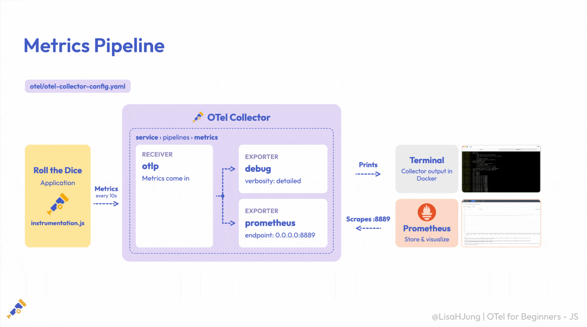

That's the path our metrics take. But what can they actually tell us about our app?

## Metrics in a coffee shop

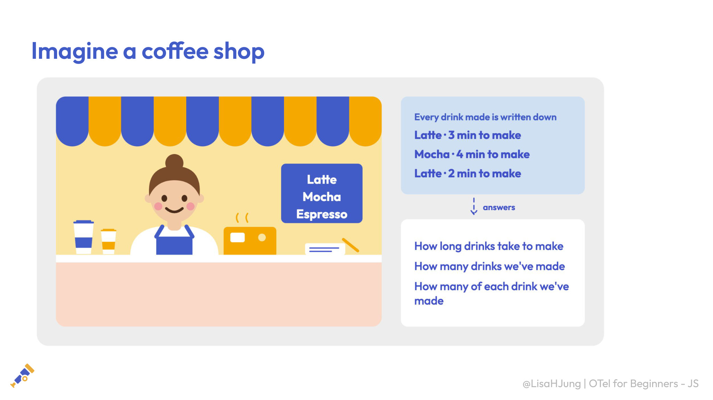

Let's step away from the code for a moment and picture a coffee shop. Each time a drink is made, someone notes what it was and how long it took.

So far, that's a latte in three minutes, a mocha in four, and another latte in two. 

From those notes alone, we know how many drinks we've made and how fast we're serving them. Count lattes and mochas separately, and we also learn which drinks people order most.

Those numbers are metrics, and they give us a quick read on how the shop is doing.

## Metrics in our app

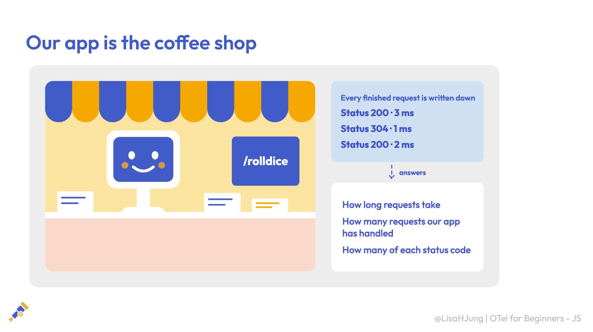

Our app works the same way, except it serves requests instead of drinks. Whenever a request finishes, the app notes its route, its status code, and how long it took.

- Counting requests tells us how busy our app is.
- Timing them tells us how quickly it responds.
- Grouping them by status code shows how many succeeded and how many failed.

Put together, these metrics paint a picture of how our app is performing. 

Let's find them in Prometheus.

## Explore our metrics in Prometheus

**1. Open the Prometheus UI**

Go to http://localhost:9090. We'll spend the rest of this episode here, exploring our metrics.

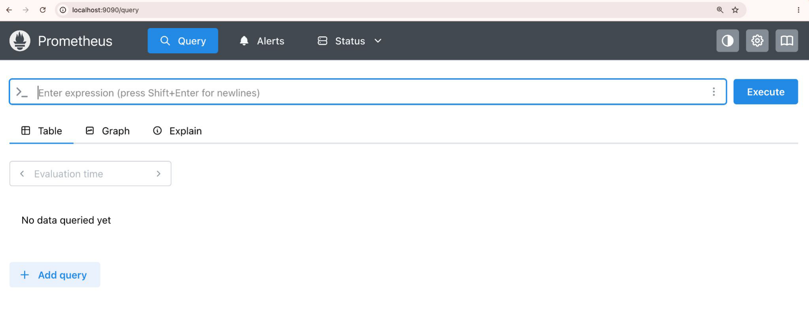

**2. Run a query**

We'll begin with a simple question. How many requests has our app handled?

Type this query into the query bar at the top of the page:

```
http_server_request_duration_seconds_count
```

This is a metric that auto-instrumentation created for us. Entering its name tells Prometheus which metric we want to see. It's a mouthful, so let's break this down. 

Think back to how we timed each drink in the coffee shop. Our app times its requests the same way, and that's what **`http_server_request_duration_seconds`** describes. The `_seconds` part tells us the unit of measurement.

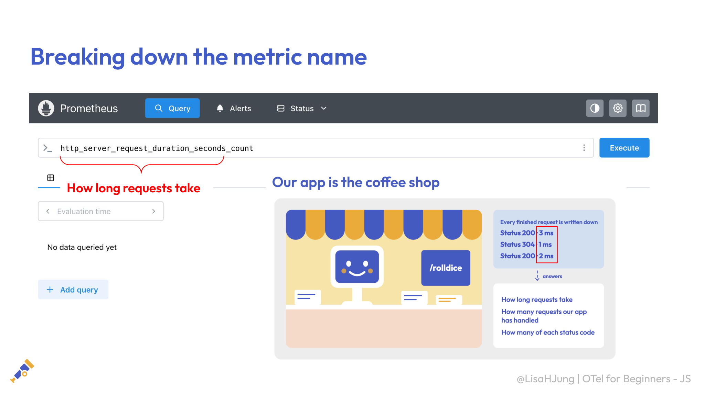


Count up those durations, and we know how many requests our app has handled. In this example, that's three. That's the **`_count`** part of the name.

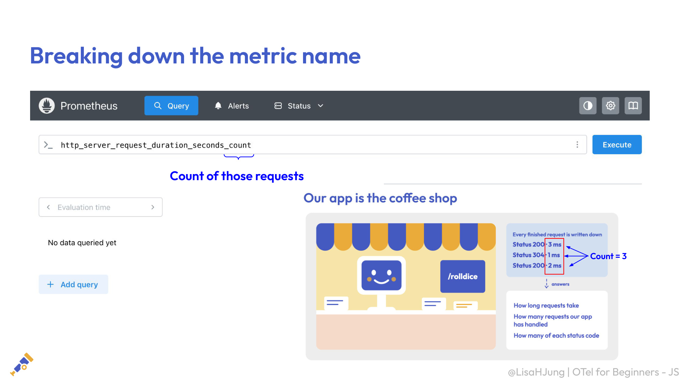

Read as a whole, the query asks, "How many requests has our app handled since it started?" Now click **Execute**.

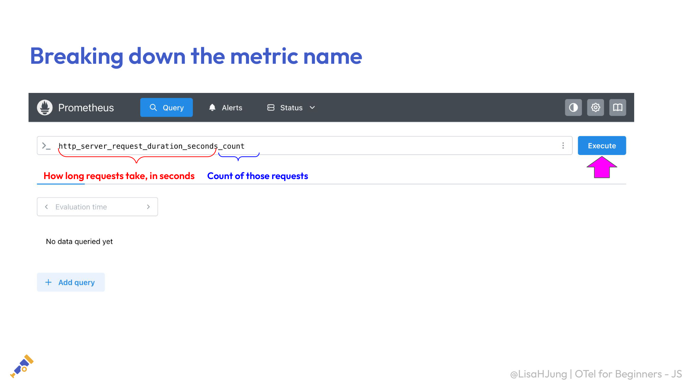

**3. Read the results in Table view**

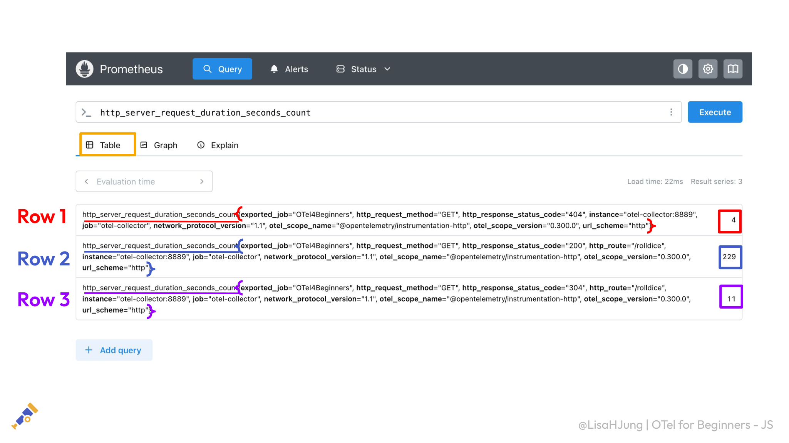

The results open in **Table** view. 

Rather than a single total, Prometheus returns three rows. Each one begins with the metric name, lists some details inside curly braces, and ends with a count on the right.

Why split the requests into groups? Our coffee shop can help explain.

### Labels

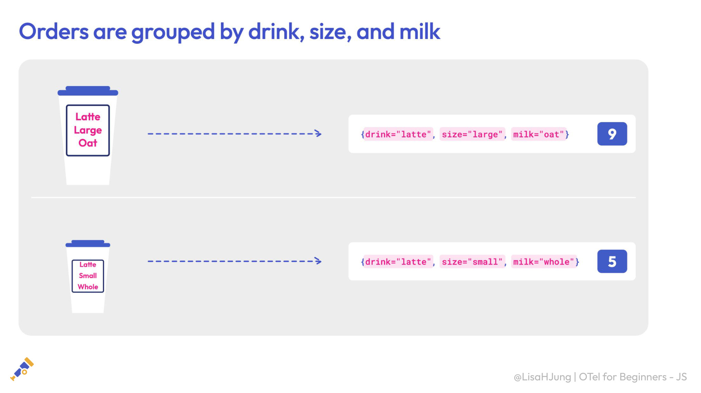

A single total doesn't tell a coffee shop much. So instead, we keep separate counts by drink, size, and milk. All the large oat lattes share one count, and small lattes with whole milk get another.

Splitting things up like this lets us ask sharper questions. Here, large oat lattes are outselling small whole milk lattes, which tells us to stock up on oat milk.

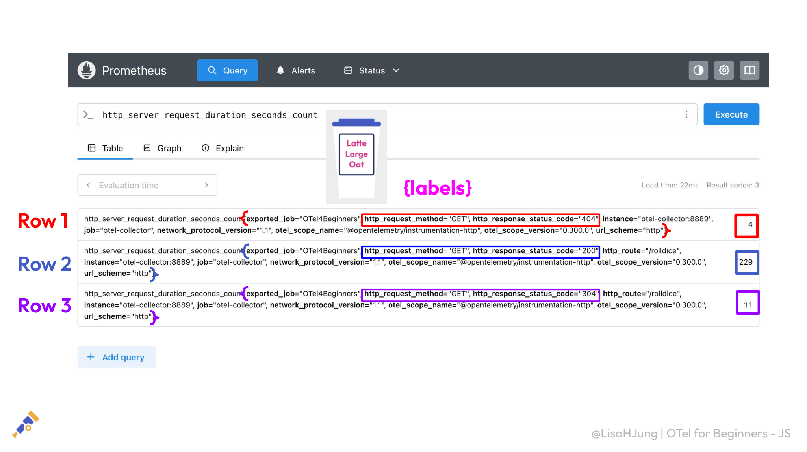

Our app groups its requests in a similar way. Instead of drink, size, and milk, it uses details like the HTTP method and status code. Those are the details inside the curly braces.

They work like the label on a coffee cup that describes the order, and in metrics, they're called **labels** too. Every unique combination of labels gets a row, and a count, of its own.

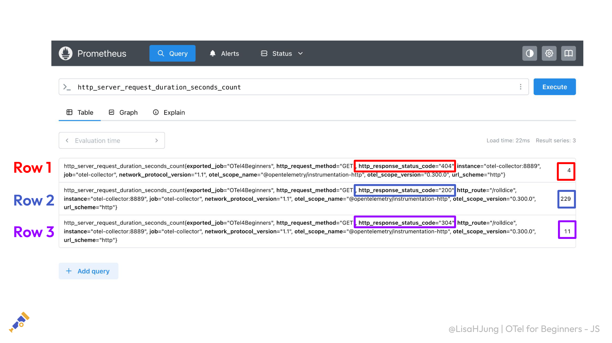

Take the status code label. Just as each drink size had its own count, each status code has its own row. In our example, we have:
- **4** failed requests with a `404`
- **229** successful requests with a `200`
- **11** requests with a `304`

> Your counts will be different. They depend on how many times you've refreshed the app.

Thanks to this grouping, we can tell at a glance how many requests succeeded and how many failed.

**4. Switch to Graph view**

Table view gives us a snapshot of each group's count. Those counts keep changing as requests come in, so click **Graph** to watch them over time.

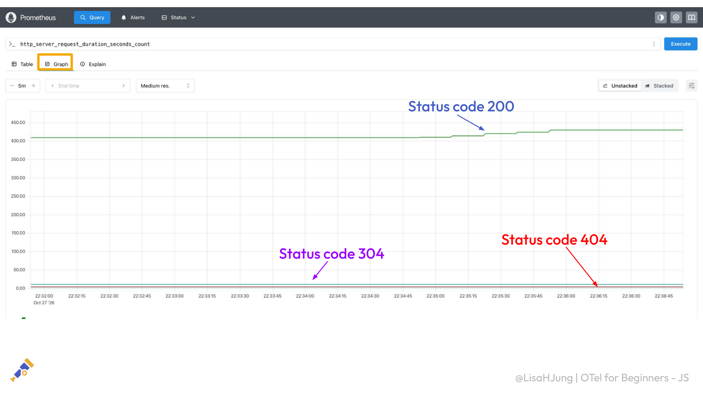

Every line here matches one of the rows from Table view. Rather than just the latest count, it shows how that count has changed over time. A line of values like this is called a **time series**.

Try it yourself. Roll the dice a few more times, give it about 30 seconds, then click **Execute** again. You'll see the line for successful requests step up.

Three groups give us three time series. So what happens when we add more labels?

### Cardinality

Let's return to the coffee shop one last time. Our two groups of drinks each have a count that changes over time, which makes two time series.

The number of time series we have is called **cardinality**, so the shop's cardinality is two.

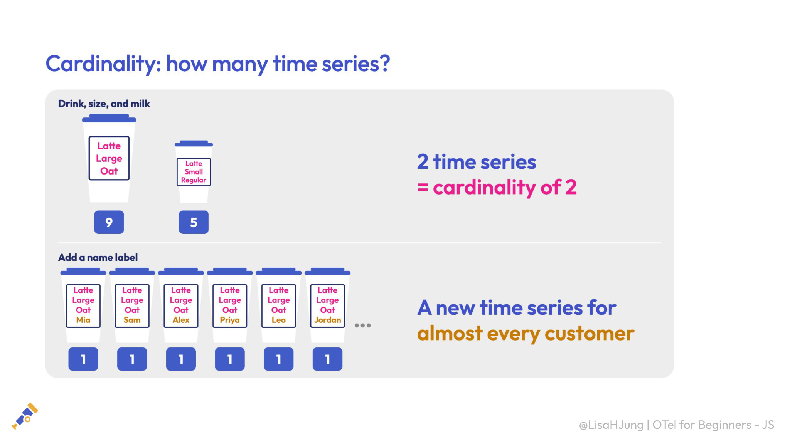

Now say we add each customer's name as a label. 

The single count for large oat lattes would break into a separate count for every customer who ordered one. Each new customer adds another time series, and that's how one extra label can drive cardinality up.

Our app follows the same rule. 

The query returned three time series, giving it a cardinality of three. Prometheus also shows this number next to **Result series**.

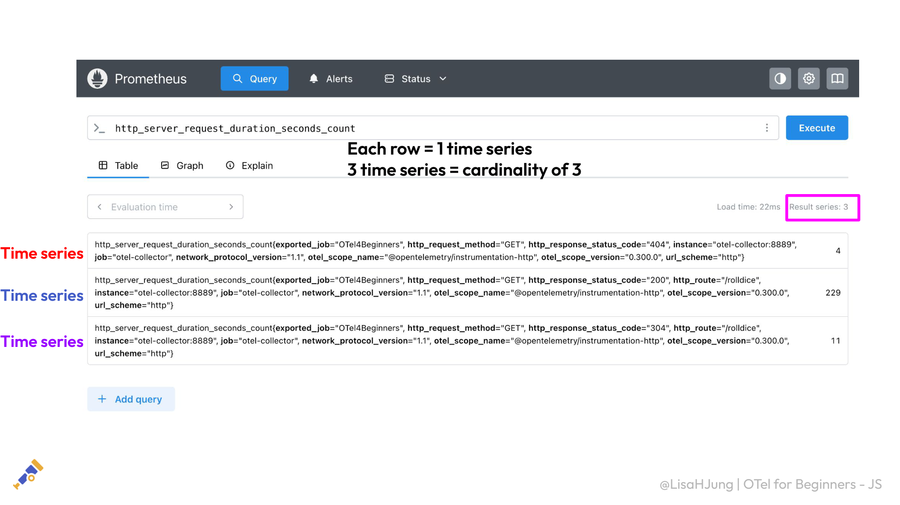

Every new combination of label values adds a time series, and every time series is more data to store. 

Over time, that can add up to higher costs. In the next episode, we'll see how the Collector can help us decide what data to keep.

### Resource attributes

Labels describe the requests themselves. **Resource attributes** describe something different, which is where our metrics came from.

We first met them with [traces](../traces/README.md#process-resource-attributes). They tell us about the service, host, and process behind our telemetry.

Most of them don't show up as labels in Prometheus, so we'll find them in the Collector's debug output instead. In the terminal running Docker, search for `Resource attributes`.

The output moves fast, so here's a screenshot to follow along with:

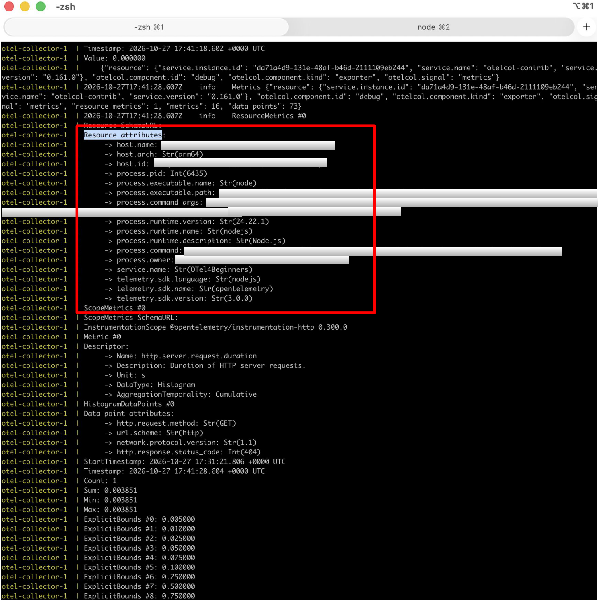

A few of these are genuinely useful. `service.name`, for example, tells us which service sent the data.

Others are more than we need for this demo, like host identifiers, the process owner, and the full command used to start the app. Their values are blurred in the screenshot, but you can still see which attributes were added automatically.

In the next episode, we'll use processors to remove these:
- `host.arch`
- `host.id`
- `host.name`
- `process.command`
- `process.command_args`
- `process.executable.path`
- `process.owner`
- `process.pid`

And that's our metrics pipeline up and running! 


We generated metrics with auto-instrumentation, sent them through a bare-bones Collector, and explored them in Prometheus, along with the labels and resource attributes that come with them.

Next, we'll put that pipeline to work. 

In the next episode, we'll add processors to clean up, enrich, and filter our metrics before they leave the Collector.

# Episode 6 - Processing Metrics: OpenTelemetry Collector in Action

In the last episode, we instrumented our app and set up a bare-bones OpenTelemetry Collector to receive and export metrics. Along the way, we noticed that our metrics carried extra labels and resource metadata we didn't really need, some of it sensitive, some of it just noise.


In this episode, we'll fix that using **processors**, which run inside the Collector and let us modify, enrich, or filter telemetry before it's exported.


## Project folders

1. `bare-bones-setup/` (**Episode 5**)
- Instruments the Roll the Dice app and sends metrics to the OpenTelemetry Collector.
- The Collector exports metrics to Prometheus with no additional processing.

2. `add-processors/` (**Current episode**)
- Uses the same setup as `bare-bones-setup`, but applies processors to incoming metrics.
- These processors enrich resource metadata, drop metrics we don't need, remove low-value or sensitive labels, and rename a metric to match current conventions.

**In the terminal running the Roll the Dice app, stop the app and navigate to the `add-processors` folder:**
```
# stop the app
Ctrl + C

# navigate to the add-processors folder
cd ../add-processors

# install dependencies and start the app
npm install
npm start
```

**In the terminal running Docker, stop and restart the Collector, Jaeger, and Prometheus:**
```
# stop and remove the running containers
docker compose down

# navigate to the add-processors folder
cd ../add-processors

# restart with the updated configuration
docker compose up
```
The Collector restart is the important step here. It's what loads the new processors config.

**Generate some metric data**

Head back to the Roll the Dice app in your browser and refresh it a few times to push fresh metrics into the newly configured Collector. 


Then switch over to the terminal running Docker, where you'll see those metrics moving through the OpenTelemetry Collector in the debug output.


With data flowing again, let's open up the configuration that's now processing it.

Switch back to the code editor. Make sure you have the metrics/add-processors folder open. Then navigate to the otel directory and open the otel-collector-config.yaml file.

## New OpenTelemetry Collector Configuration

Back in the bare-bones setup, this file had just three top-level sections, the receivers, the exporters, and the service block that organizes our pipelines. Now a fourth one joins them, `processors`, which is where each processor gets defined.

Because we're building on top of the traces episodes, the file lays out both a traces pipeline and a metrics pipeline, and the two lean on a couple of shared processors. Our attention here is on the **metrics** pipeline, which puts four processors to work.

Each one has a distinct job, so we'll walk through them one at a time, in the order `resource`, `attributes/metrics`, `filter/exclude_metrics`, and `metricstransform`. The order they actually run in inside the pipeline is a little different, and we'll come back to that once we've seen what each one does.

**otel/otel-collector-config.yaml**
```
receivers:
  otlp:
    protocols:
      grpc:
        endpoint: 0.0.0.0:4317
      http:
        endpoint: 0.0.0.0:4318

processors:
  # Add/modify resource-level attributes (applies to both traces and metrics)
  resource:
    attributes:
      - key: deployment.environment.name
        value: local
        action: insert
      - key: host.arch
        action: delete
      - key: host.id
        action: delete
      - key: host.name
        action: delete
      - key: process.command
        action: delete
      - key: process.command_args
        action: delete
      - key: process.executable.path
        action: delete
      - key: process.owner
        action: delete
      - key: process.pid
        action: delete

  # Modify span attributes (for traces)
  attributes/traces:
    actions:
      - key: http.user_agent
        action: delete
      - key: net.host.ip
        action: delete
      - key: net.peer.ip
        action: delete
      - key: net.host.port
        action: delete
      - key: net.peer.port
        action: delete

  # Modify metric datapoint attributes (for metrics)
  attributes/metrics:
    actions:
      - key: net.host.port
        action: delete

  # Filter out unwanted metrics to reduce cardinality
  filter/exclude_metrics:
    error_mode: ignore
    metrics:
      metric:
        - 'name == "v8js.memory.heap.space.physical_size"'

  # Rename and transform metrics
  metricstransform:
    transforms:
      - include: http.server.duration
        action: update
        new_name: http.server.request.duration

exporters:
  debug:
    verbosity: detailed

  otlp/jaeger:
    endpoint: jaeger:4317
    tls:
      insecure: true
    sending_queue:
      sizer: items
      batch:
        flush_timeout: 5s
        min_size: 512

  prometheus:
    endpoint: 0.0.0.0:8889

service:
  pipelines:
    traces:
      receivers: [otlp]
      processors: [resource, attributes/traces]
      exporters: [debug, otlp/jaeger]
    metrics:
      receivers: [otlp]
      processors: [resource, filter/exclude_metrics, attributes/metrics, metricstransform]
      exporters: [debug, prometheus]
```

With the full config in view, here's the role each of the four processors plays for our metrics.

**1. The `resource` processor modifies metadata about the service or host.**

You already saw this one in the traces processing episode, and it's the very same processor here, shared by both the traces and metrics pipelines. 

```
processors:
  # Add/modify resource-level attributes (applies to both traces and metrics)
  resource:
    attributes:
      - key: deployment.environment.name
        value: local
        action: insert
      - key: host.arch
        action: delete
      - key: host.id
        action: delete
      - key: host.name
        action: delete
      - key: process.command
        action: delete
      - key: process.command_args
        action: delete
      - key: process.executable.path
        action: delete
      - key: process.owner
        action: delete
      - key: process.pid
        action: delete
```

On the way in, it adds a `deployment.environment.name` attribute and sets it to `local`. That makes it obvious at a glance which environment our metrics came from. It also uses the `delete` action to remove the host and process attributes we saw in the bare-bones debug output. Those were the ones that were sensitive, redundant, or just noise.

To see the difference, we'll look at the Collector's debug output rather than the Prometheus UI. Resource attributes describe the app producing the telemetry. In this setup, they are not exposed as Prometheus labels, so the debug output is the clearest place to compare before and after. 

In the screenshot, the raw telemetry sits on the left and the processed version on the right. The `deployment.environment.name` attribute has been added (green box). The unnecessary host and process attributes are gone (red boxes).


**2. The `attributes/metrics` processor modifies the labels attached to each metric.**
```
attributes/metrics:
    actions:
      - key: net.host.port
        action: delete
```
Where the resource processor works on the telemetry's source, this one works on the labels attached to each metric. We use it to delete `net.host.port`, a label that describes the network rather than anything the app itself is doing. Dropping it keeps our metrics centered on application behavior, and it lowers cardinality at the same time.

Because metric labels show up as Prometheus labels, this is easy to verify there. Looking back at the bare-bones query for `http_server_duration_milliseconds_count`, Prometheus returned three time series, and every one of them carried a `net_host_port` label. 


Now switch back to the live Prometheus UI and run the HTTP request duration query again:
```
http_server_request_duration_milliseconds_count
```
This time the metric comes back without the `net_host_port` label. That's the effect of the attributes processor.


**3. The `filter/exclude_metrics` processor drops entire metrics we don't need.**
```
filter/exclude_metrics:
    error_mode: ignore
    metrics:
      metric:
        - 'name == "v8js.memory.heap.space.physical_size"'
```
So far we've trimmed a single label. This processor goes a step further and drops an entire metric. 

Not every metric our app emits is useful, and every one we hold onto adds to storage, query cost, and overall telemetry volume. 

In our config, we're removing a low-level V8 runtime metric, `v8js.memory.heap.space.physical_size`, which reports the physical size of individual heap spaces.

That's more detail than this app needs. The memory signals that actually matter, like heap used and heap limit, stay put. Inside the pipeline we run this filter **early**, ahead of the label cleanup and renaming, so we don't spend effort on metrics we're about to drop anyway.

To confirm it worked, we can query the metric in Prometheus before and after. Beforehand the query returns the metric as expected. 


Once the processor is in place the same query comes back empty, because the Collector filtered it out before export.


**4. The `metricstransform` processor reshapes metrics, including renaming them.**
```
metricstransform:
    transforms:
      - include: http.server.duration
        action: update
        new_name: http.server.request.duration
```
OpenTelemetry's semantic conventions keep evolving, and metric names occasionally shift from one version to the next. Using this processor, we rename `http.server.duration` to `http.server.request.duration` so our telemetry stays current, and we do it without touching a line of application code.

We can confirm the rename in Prometheus by querying the old name and the new name. Querying the old name returns data before the processor is applied.


But afterward that same query comes back empty, since the metric no longer goes by that name. 


Query the new name instead and the data reappears.


One detail worth calling out is that the name in Prometheus doesn't match the one in our config. In the Collector configuration it's `http.server.request.duration`, but in Prometheus it shows up as `http_server_request_duration_milliseconds_count` (highlighted in orange). 


That's the Prometheus exporter doing its job. On the way out it rewrites names to follow Prometheus conventions, swapping dots for underscores and tacking on the unit and metric-type suffix. That's how `http.server.request.duration` ends up as `http_server_request_duration_milliseconds_count`.


**What about batching?**

If you followed the traces processing episode, you might expect a `batch` processor at the end of the metrics pipeline. You won't find one here.

Prometheus **pulls**, or scrapes, metrics from the Collector. The Collector never pushes metrics out to Prometheus itself, so there's nothing to batch on the way out.

Traces work differently. The Jaeger exporter **pushes** spans to Jaeger, so they're still batched. Instead of a standalone `batch` processor, the batching now happens in the exporter's `sending_queue`, which is where the Collector is moving batching:
```
otlp/jaeger:
    endpoint: jaeger:4317
    tls:
      insecure: true
    sending_queue:
      sizer: items
      batch:
        flush_timeout: 5s
        min_size: 512
```
We'll take a closer look at how `sending_queue` works in the logs episodes.

**The `service` component is what ties everything together, connecting our receivers, processors, and exporters into an actual pipeline.**

One thing to keep in mind is that defining a processor up in the top-level `processors` section only makes it available. It doesn't put it to work. A processor runs only when we list it inside a pipeline, and that list pulls double duty. It decides both which processors run and the order they run in.
```
service:
  pipelines:
    metrics:
      receivers: [otlp]
      processors: [resource, filter/exclude_metrics, attributes/metrics, metricstransform]
      exporters: [debug, prometheus]
```

**IMPORTANT**

Processors run in the exact order they're listed in the pipeline, so for our metrics that's `resource`, then `filter/exclude_metrics`, then `attributes/metrics`, and finally `metricstransform`.
- Filtering comes **early** on purpose. We drop the metrics we don't want before spending any effort transforming the ones we're keeping.

With these processors in place, our Collector is no longer just passing data through. It's actively transforming our telemetry, adding useful context, dropping metrics we don't need, removing low-value or sensitive labels, and renaming metrics to match current conventions.

In this episode, we put processors to work transforming our metrics inside the OpenTelemetry Collector. 

In the next one, we'll shift our focus to the third signal, logs, and see how to collect, process, and export them with OpenTelemetry.
